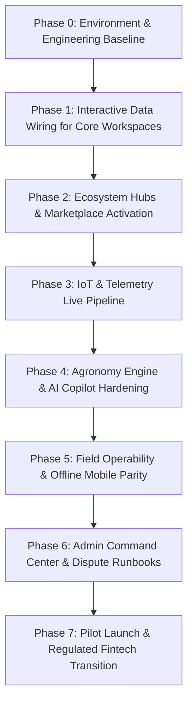

# CultivaNode — Master Build Plan & System Archaeology

**Authoritative System Blueprint & Execution Roadmap**  
**Project:** CultivaNode (Agri-Intelligence & Enterprise Farm Operating System)  
**Baseline Date:** 11 October 2026  
**Status:** Approved Master Build Plan  
**Repository:** `cultivanode` (Turborepo Monorepo)  
**Target Environment:** Web (Next.js 16 App Router) · Mobile (Expo SDK 57 React Native) · Backend (Supabase Postgres 17 + PostGIS)

---

## 1. Executive Summary & Product Archaeology

### 1.1 What CultivaNode Is About
**CultivaNode** is an end-to-end digital agricultural operating system and multi-stakeholder service marketplace purpose-built for African agriculture, starting with smallholder and commercial farmers in South-West Nigeria (Oyo, Ogun, Osun, Ondo, Ekiti, and Lagos States).

The platform bridges the critical infrastructure and information gaps that plague smallholder and commercial agribusiness across the continent:
1. **Cadastral & Land Registry Fragmentation:** Lack of georeferenced land boundaries, unverified soil data, and informal land tenure.
2. **Mechanization Deficit:** Low tractor density and poor utilization of heavy equipment (ploughs, harrows, harvesters, boom sprayers).
3. **Agronomic Information Vacuum:** Farmers relying on unverified word-of-mouth advice or dangerous, banned agro-chemicals without Good Agricultural Practice (GAP) standards.
4. **Disorganized Value Chains:** Fragmented produce offtake, volatile farmgate pricing, uncoordinated logistics, and lack of traceability.
5. **Credit & Insurance Invisibility:** Formal banks (lenders) and underwriters (insurers) cannot assess farm risk due to zero credible historical records.
6. **Harsh Field Realities:** Intermittent mobile connectivity, high solar glare, low-end Android hardware, and linguistic diversity (English, Yorùbá, Nigerian Pidgin).

CultivaNode resolves this by operating as **Connected Intelligence for Agriculture — Your Farm's Working Partner**: a single unified digital nervous system connecting farmers, tractor operators, agro-dealers, produce aggregators, cooperatives, extension agents, financial institutions, and government monitors on a shared, verified database.

---

### 1.2 Core Architectural Principles & Boundaries

1. **Ground Truth Over Assumptions:** Recommendations are strictly advisory. CultivaNode never blocks or overrides a farmer’s real-world practice. The system uses a strict **Standard → Plan → Actual (SPA)** variance model.
2. **Trust Before Transactions:** Every participant is verified through a multi-tier identity model (Tier 0: Phone OTP → Tier 1: NIN → Tier 2: BVN + Bank Account → Tier 3: Trusted Provider).
3. **Direct-Payment Pilot Boundary:** In the initial pilot phase, CultivaNode charges 0% commission and facilitates direct payment between farmers and service providers (cash or bank transfer). No funds are handled directly until regulatory fintech licensing is finalized (Phase P6).
4. **Proof of Work (PoW) Integrity:** Every mechanization job requires GPS check-in (geofence verified inside farm boundary), timestamped before/after photo evidence, and bilateral confirmation before completion.
5. **Defensive Agronomy & Chemical Guardrails:** Agronomic advisory is strictly grounded in NAFDAC, IITA, and NIHORT standards. The AI assistant strictly blocks banned chemicals (Paraquat, Carbofuran, DDT) and never invents chemical dosages.
6. **Field-First Usability:** 48px minimum touch targets, high-contrast WCAG AA compliance, full Yorùbá diacritics support, and offline-first data queues for Android devices in rural areas.
7. **Standing Order: Front-End Primacy & Backend Accommodation:** The front-end syntax, UX workflows, and naming conventions take absolute precedence across all modules. Where existing backend schemas, tables, columns, or calculation engines differ or lack support, the backend and engines must be built, adapted, and extended to satisfy the front-end without stripping or downgrading UI capabilities. Never delete or downgrade front-end capabilities to match legacy backend limitations. When a UI field exists, the backend must persistently store and retrieve it.

---

## 2. Codebase Anatomy & Technical Architecture

```
cultivanode/
├── apps/
│   ├── web/                     # Next.js 16 (App Router, React 19, Tailwind CSS v4, shadcn/ui)
│   │   ├── src/app/[lang]/      # Public site, localized marketing, and authenticated account workspaces
│   │   ├── src/app/admin/       # Super Admin & Operations Console (English only, unindexed)
│   │   ├── src/actions/         # High-integrity Server Actions (auth, bookings, crops, farm-ops, etc.)
│   │   ├── src/components/
│   │   │   ├── ds/              # Design System chrome (SiteHeader, SiteFooter, Nav, LocaleSwitch)
│   │   │   ├── screens/         # 64 High-fidelity Agro-Enterprise Suite screen components
│   │   │   └── shadcn/          # Accessible UI primitives (Button, Card, Dialog, Table, Sheet, etc.)
│   │   └── src/lib/             # Supabase clients, session helpers, logger, and monitoring
│   └── mobile/                  # Expo SDK 57 (React Native, TypeScript, Android-first)
│       ├── src/screens/         # Phone sign-in, onboarding, and mobile dashboard
│       └── src/lib/             # Offline queue, SQLite storage, and AES-encrypted session store
├── packages/
│   ├── shared/                  # Universal business engines, schemas, and design tokens
│   │   ├── src/brand.ts         # Brand lockup, tagline, and theme constants
│   │   ├── src/database.types.ts# Generated Supabase TypeScript types
│   │   ├── src/design/tokens.ts # Design tokens (colors, typography, spacing, elevations)
│   │   ├── src/roles.ts         # Enums & role definitions
│   │   └── src/engines/         # Core business calculation engines:
│   │       ├── agronomy/        # Crop templates, planting calendars, fertilizer algorithms
│   │       ├── ai-assistant/    # Dual LLM grounding engine (Gemini 2.5 Flash + OpenAI) & guardrails
│   │       ├── farm-management/ # SPA variance, inventory, livestock, machinery, cost engines
│   │       ├── iot/             # Sensor quality checker, alert rules, and crop bridge
│   │       ├── ledger-escrow/   # Cryptographic double-entry ledger & escrow state machine
│   │       └── marketplace/     # Multi-seller order state machine, fee calculations, traceability
│   └── iot/                     # @cultivanode/iot-module: Hardware ingestion & telemetry package
│       ├── src/engine/          # Alert rules engine, watchdog, and crop bridge
│       ├── src/ingestion/       # Cellular & LoRaWAN payload adapters, quality filtering pipeline
│       └── src/simulator/       # Node simulator, soil physics model, weather generator
└── supabase/
    ├── migrations/              # 30+ PostgreSQL migrations (PostGIS, Identity, Farms, Marketplace, IoT)
    ├── tests/database/          # 270+ pgTAP tests validating RLS, grants, and constraints
    └── config.toml              # Local Supabase development configuration
```

---

## 3. Complete Website Archaeology — Features & Functionalities

The CultivaNode web ecosystem consists of **64 comprehensive screens** covering the public portal, three primary role workspaces, 14 specialized ecosystem hubs, and the super administrative console.

### 3.1 Public Portal & Marketing Surfaces
| Route | Component | Purpose & Functionality |
|---|---|---|
| `/[lang]` | `HomePage` | Primary landing page. Brand promise, 3 interactive scenes (Plan, Hire, Record), live hero picture carousel from admin, pilot notice, Yoruba/English locale switch. |
| `/[lang]/platform` | `PlatformCapabilities` | Detailed breakdown of the 6 core pillars of the Agro-Enterprise Suite (GIS, Agronomy, Mechanization, Commerce, IoT, Credit). |
| `/[lang]/solutions` | `SolutionsByRole` | Solution guides tailored by persona (Farmers, Equipment Owners, Aggregators, Banks, Government). |
| `/[lang]/how-it-works` | `HowItWorks` | Interactive step-by-step guides explaining how jobs, crop planning, and verification work. |
| `/[lang]/marketplace` | `OpenMarketplace` | Public multi-category marketplace directory (Machinery, Services, Inputs, Seeds, Produce). Filter by state, LGA, category, price. |
| `/[lang]/marketplace/[id]`| `ListingDetail` | Detailed listing page with pricing units (₦/hr, ₦/day, ₦/ha, ₦/job), equipment specifications, provider verification badge. |
| `/[lang]/marketplace/checkout` | `MarketplaceCheckout` | Multi-item checkout flow with delivery/service location selection and payment breakdown. |
| `/[lang]/marketplace/rfq` | `RFQPage` | Request-For-Quote workflow for bulk agricultural commodity and input purchasing. |
| `/[lang]/machinery` | `MachineryDirectory` | Dedicated mechanization catalog for booking tractors, combine harvesters, and implements. |
| `/[lang]/farmers` | `FarmersPage` | Targeted value proposition for smallholders and commercial farm estates. |
| `/[lang]/service-providers`| `ProvidersPage` | Onboarding gateway for tractor owners, mechanics, and spraying operators. |
| `/[lang]/crops` & `resources` | `AgronomyLibrary` | Open agronomy knowledge base containing Good Agricultural Practices (GAP) for Nigerian crops. |
| `/[lang]/about` | `AboutPage` | Company origin, leadership, agricultural mission, and core operating principles. |
| `/[lang]/partners` | `PartnershipsPage` | Directory of institutional, research, and technical partners (IITA, NIHORT, etc.). |
| `/[lang]/contact` | `ContactPage` | Inquiry form submitting directly to `send_contact_message()` database function. |
| `/[lang]/faq` | `FAQPage` | Multilingual FAQ answering common questions about identity, bookings, payments, and disputes. |
| `/[lang]/waitlist` | `PilotPage` | Pilot registration waitlist submitting to `join_waitlist()`. |
| `/[lang]/legal`, `terms`, `privacy` | `LegalGovernance` | Statutory Nigeria Data Protection Act (NDPA) notices, direct payment terms, and privacy disclosures. |
| `/[lang]/sign-in`, `sign-up` | `AuthPages` | Phone OTP authentication (via Termii SMS) with email OTP fallback, 60s cooldown timer. |
| `/[lang]/onboarding`, `review` | `OnboardingWizard` | Multi-step role selection, business entity setup, Tier 1/2 KYC submission, and statutory consents. |

---

### 3.2 Farmer Workspace (`/account` with `ws=farmer`)

#### A. Farm Operations
- **Overview (`/account`):** Time-aware Yorùbá greeting (`Ẹ káàrọ̀`, `Ẹ káàsán`, `Ẹ kúrọ̀lẹ́`), KPI tiles (Land under management, Active operations, Services booked ₦, Verification Tier), quick actions (Register Farm, Book Machinery, Plan Crop Cycle), and upcoming job execution table.
- **My Farms & Fields (`/account/farms`):** Farm registry listing all holdings, PostGIS boundary status, agro-ecological zone detection (Rainforest vs Derived Savanna), soil profile records, and plot allocation breakdown.
- **Farm Map & Cadastre (`/account/farms/map`):** Interactive PostGIS map displaying boundary polygons, elevation contours, plot boundaries, and GPS coordinates.
- **Field Profile (`/account/farms/field`):** Micro-plot dossier with soil pH, nitrogen/phosphorus/potassium (NPK) baseline, topography, water source, and cropping history.
- **Register New Farm (`/account/farms/new`):** Cadastral registration wizard supporting GPS pin drop, boundary vertex walking, manual coordinates entry, and automatic polygon area calculation (`compute_area_from_boundary`).
- **Crop Management (`/account/crops`):** Active crop cycles dashboard, growth stage phenology timelines (Germination, Vegetative, Flowering, Grain Fill, Maturity), and projected harvest schedules.
- **Crop Cycle Detail (`/account/crops/[id]`):** Field-level operations tracker (ploughing, harrowing, planting, basal fertilizing, weeding, top-dressing, pest control, harvest) with daily progress and observation logs.
- **Field Scouting (`/account/crops/scouting`):** Field scouting logger with camera upload, GPS geotagging, pest/disease identification (Fall Armyworm, Cassava Mosaic, Tomato Blight), and weed severity ratings.
- **Livestock & Aquaculture (`/account/livestock`):** Individual animal tag tracking (RFID/ear tag) and herd/flock management (Cattle, Goats, Sheep, Poultry, Fish ponds), vaccination schedules, feed conversion ratio (FCR), mortality rates, and milk/egg production logs.
- **Field Operations & Calendar (`/account/tasks`):** Operational task calendar, worker task assignments, scheduled vs actual execution dates, and weather advisory alerts.

#### B. Machinery & Automation
- **Service & Machinery Marketplace (`/account/find`):** Spatial nearby search (`nearby_listings()`) finding tractors, implements, and operators within a specified radius (up to 100km).
- **My Bookings (`/account/bookings`, `[id]`):** Complete booking lifecycle: Request → Accept → GPS Check-in → Proof of Work Upload → Confirm → Mark as Paid → Bilateral Rating.
- **Fleet & Workshop (`/account/machinery`):** Farmer-owned machinery registry, implement hitch compatibility, engine operating hours, fuel usage, and workshop maintenance logs.
- **Telemetry & Tracking (`/account/machinery/telemetry`):** Real-time GPS tracking of machinery working on fields, speed monitoring, and hectare coverage counters.
- **IoT & Smart Farm (`/account/iot`):** Live telemetry from field sensors (soil moisture at 15cm & 30cm root depths, canopy temperature, ambient humidity, rainfall), device health, battery levels, and signal RSSI.
- **Smart Irrigation (`/account/irrigation`):** Water infrastructure monitoring (borehole flow rates, tank levels) with automated irrigation alerts tied to soil moisture thresholds.
- **Inventory & Supplies (`/account/inventory`):** Multi-location stock tracker (main store, chemical room, feed shed), batch/lot numbers, expiration dates, concurrency-safe stock receipts and issues.

#### C. Commerce & Finance
- **Produce & Harvest Commerce (`/account/harvest`):** Harvest batch logging, quality grading (Grade A/B/C), packaging, direct listing to marketplace, and grain aggregation bin tracking.
- **Off-take Contracts (`/account/contracts`):** Forward contracts with institutional buyers, contracted tonnage, guaranteed floor prices, delivery deadlines, and moisture specifications.
- **Farm Books & Accounting (`/account/finance`):** Double-entry farm ledger in Naira (₦) and kobo, cost allocation per hectare/plot/crop, revenue tracking, gross margin analysis, and printable financial statements.
- **Verified Records & Credit (`/account/reports`):** Farm credit-readiness dossier combining cadastral boundaries, verified input purchases, satellite NDVI, and historical harvest yields for bank and insurer review.

#### D. Intelligence
- **Farm Health & Risk (`/account/risk`):** Automated farm risk scoring (drought risk, pest pressure, price volatility, flood index).
- **CultivaNode Intelligence & AI (`/account/assistant`):** Grounded agricultural AI assistant powered by Gemini 2.5 Flash and OpenAI fallback. Provides verified GAP advice in English, Yorùbá, and Nigerian Pidgin with strict chemical safety guardrails.

---

### 3.3 Service Provider Workspace (`/account` with `ws=provider`)
- **Operator Dispatch & PoW (`/account`):** Provider home displaying incoming job requests, operator dispatch assignments, route planning, and active job status.
- **Job Requests & Bookings (`/account/bookings`):** Job acceptance, quote negotiation, rescheduling, and status management.
- **My Listings (`/account/listings`):** Equipment and labour listings with multi-unit rate definitions (₦/hour, ₦/day, ₦/hectare, ₦/job), service radius, and minimum callout fees.
- **Proof-of-Work Log (`/account/machinery/dispatch`):** Evidence submission portal: GPS check-in (verified inside the farmer's boundary), before-work photos, after-work photos, completed hectare meters.
- **Fleet & Workshop (`/account/machinery`):** Equipment health, preventive maintenance alerts, and repair records.
- **Logistics & Haulage (`/account/logistics`):** Flatbed transport scheduling for moving heavy tractors between distant farm clusters.
- **Earnings & Books (`/account/finance`):** Direct payments recorded, fuel and operator expense breakdown, and net job profitability.

---

### 3.4 Field Agent Workspace (`/account` with `ws=agent`)
- **Assisted Onboarding Hub (`/account`):** Agent cluster dashboard: registered farmers, pending verifications, mapped hectares, and farmer engagement stats.
- **Register a Farmer (`/account/agent`):** Field registration workflow with SMS OTP confirmation by the farmer, establishing verifiable provenance (`onboarded_by`).
- **Book for a Farmer (`/account/bookings/new`):** Agent-assisted machinery booking on behalf of non-smartphone farmers, requiring farmer consent and transparent pricing.
- **Cooperative Management (`/account/cooperative`):** Organizing farmer clusters, bulk input procurement, and shared equipment scheduling.
- **Field Scouting (`/account/crops/scouting`):** Extension scouting visits, pest outbreak reporting, and crop health surveys across the cluster.

---

### 3.5 The 14 Specialized Ecosystem Hubs
1. **Produce Buyer & Aggregator (`/account/buyer`):** Sourcing produce by crop variety and moisture grade, managing buying stations, aggregating smallholder harvests, and tracking offtake delivery.
2. **Input Supplier & Agro-dealer (`/account/supplier`):** Catalogue management for certified seeds, fertilizers, and crop protection; inventory tracking across rural retail shops; wholesale fulfillment.
3. **Logistics & Haulage (`/account/logistics`):** Agricultural freight fleet management, waybill generation, route dispatch, transit condition monitoring (temperature, delay).
4. **Agro-processing (`/account/processing`):** Raw material intake queues, milling/extraction processing efficiency, output batch tracking, quality lab test logs.
5. **Cooperative Dashboard (`/account/cooperative`):** Member registers, cooperative dues and share capital, bulk purchasing orders, and produce aggregation pooling.
6. **Enterprise Agribusiness (`/account/enterprise`):** Outgrower scheme governance, multi-estate plantation management, corporate ESG metrics, export certification compliance.
7. **Lender & Agri-credit (`/account/lender`):** Credit assessment portal reviewing farm credit dossiers, loan disbursement tracking, crop lien records, repayment monitoring.
8. **Insurance & Underwriting (`/account/insurance`):** Parametric weather-index policy underwriting, satellite NDVI flood/drought validation, automated claim processing.
9. **Grants & Subsidies (`/account/grants`):** Government/NGO agricultural grant disbursement, subsidized input voucher distribution, beneficiary impact verification.
10. **Investor Hub (`/account/investor`):** Macro agricultural intelligence, portfolio yield metrics, capital allocation tracking, verified impact metrics.
11. **Government Intelligence (`/account/gov`):** State and regional food security indicators, strategic grain reserve monitoring, commodity price stabilization metrics, pest epidemic tracking.
12. **NGO & Development (`/account/ngo`):** Smallholder livelihood interventions, women-in-agriculture initiatives, extension adoption metrics, donor reporting.
13. **Research & Extension (`/account/research`):** Multi-location cultivar trial data, pest resistance surveillance, soil health research, field demonstration plots.
14. **Food Security & Market Intel (`/account/market-intel`):** Real-time commodity market prices across major trading hubs (Bodija, Dawanau, Mile 12), supply-demand forecasting, transport corridor bottlenecks.

---

### 3.6 Account Administration, Messaging & Compliance
- **Messaging Hub (`/account/messages`):** Peer-to-peer real-time communication between farmers, service providers, buyers, and agents.
- **Notification Centre (`/account/inbox`):** Alerts for booking requests, weather warnings, task reminders, and KYC updates.
- **Workspace Settings (`/account/settings`):** Profile details, business memberships (`org_members`), staff role delegation (farm_manager, storekeeper, accountant), security credentials.
- **Verification Hub (`/account/verification`):** Submission and tracking of KYC verification tiers (NIN, BVN, verified bank account, business CAC documents).
- **Privacy & Compliance (`/account/privacy`):** Nigeria Data Protection Act (NDPA) privacy portal: data export (`export_my_data()`), consent toggles, account deletion requests.

---

### 3.7 Super Admin & Operations Console (`apps/web/src/app/admin/`)
- **Operations:**
  - Overview (`/admin`): Executive KPI command center, daily sign-up charts by channel, weather alerts in pilot states.
  - System Health (`/admin/health`): Real-time connection status for Supabase, Edge Functions, SMS delivery queues, and background cron jobs.
  - Jobs Console (`/admin/jobs`, `[id]`): Complete timeline of all platform bookings, GPS coordinates inspection, proof photos verification.
  - Dispute Resolution & PoW (`/admin/disputes`, `[id]`): Evidence locker, photo analysis, GPS geofence auditing, staff adjudication decisions (uphold, reject, strike).
  - Cancellations (`/admin/cancellations`): Cancellation audits, weather force majeure verifications, provider strike tracking.
  - Support Desk (`/admin/support`): Customer ticket triage, SLA monitoring, agent escalation desk.
- **People & Verification:**
  - User Directory 360° (`/admin/users`, `[id]`): Full user dossier, KYC tier, linked farms, listings, booking history, fraud flags.
  - Verification & KYC (`/admin/approvals`): Manual document review queue for CAC business certificates and government IDs.
  - Staff & Field Agents (`/admin/access`): Admin role assignment (`super_admin`, `verification_officer`, `support_disputes`, `agronomy_editor`, `finance_officer`), agent HMAC code generation.
- **Marketplace & Finance:**
  - Platform Finance (`/admin/finance`): Direct payment monitoring, gross volume rollups, commission policy management.
  - Equipment & Listings (`/admin/marketplace`): Listing moderation queue, price range validation, scam suppression.
  - Operations Analytics (`/admin/analytics`): Funnel conversion (sign-up → verified → booked → completed), retention cohorts.
  - Geographic Map (`/admin/geo`): PostGIS visualization of active farms, machinery providers, and agent clusters across Nigeria.
- **Configuration & Trust:**
  - Content & Knowledge (`/admin/content`): CMS for hero carousel images, localized announcements, FAQ articles.
  - Agronomy Standards (`/admin/agronomy`): Versioned crop growth stages, fertilizer protocols, spray safety rules.
  - Integrations & APIs (`/admin/integrations`): Switchable provider adapters (SMS: Termii/Twilio/Mock; Identity: Prembly/Dojah/Smile ID/Mock; Weather: Open-Meteo/NiMet; Payments: Paystack/Flutterwave/Mock) with credentials stored in Supabase Vault.
  - Security, Audit & Compliance (`/admin/audit`): Immutable append-only audit log (`audit_log`) recording actor, action, timestamp, IP, and old/new values.
  - Privacy Requests (`/admin/privacy`): Review and resolution of statutory NDPA data export and deletion requests.
  - Website Inbox (`/admin/inbox`): Management and replies for public contact form inquiries.

---

## 4. Current State & Gap Analysis

### 4.1 What Is 100% Complete & Built
- **Monorepo & Turborepo Foundations:** TypeScript workspaces (`web`, `mobile`, `shared`, `iot`).
- **Database Schema:** 30+ migrations applied to hosted Supabase project `cultivanode` (`vqbtnftnxyfaembwgfrk`), including PostGIS geographic extensions, identity, farms, marketplace, modular farm management, and IoT schemas.
- **Design System:** Tailwind CSS v4 token system, shadcn/ui components, Plus Jakarta Sans typography, self-hosted Material Symbols subset, and full Yorùbá diacritics.
- **Public Website & Localization:** High-fidelity responsive public pages in English and Yorùbá.
- **Authentication & KYC:** Phone OTP, email OTP fallback, tier-0 through tier-2 verification, business accounts, and field agent onboarding.
- **Service Bookings & PoW Foundations:** Booking state machine, GPS check-in, private proof photo storage, ratings, dispute logging, auto-confirm worker.
- **Agronomy & AI Engines:** Grounded Gemini 2.5 Flash / OpenAI assistant with chemical safety guardrails; deterministic fertilizer/spray calculators.
- **IoT Module:** `@cultivanode/iot-module` engine with cellular/LoRaWAN adapters, watchdog, alert rules engine, soil physics simulation, and web dashboard.
- **64 Screen Components:** All 64 high-fidelity Agro-Enterprise Suite screen components are ported into `apps/web/src/components/screens/`.

### 4.2 Gaps to Resolve (The "To-Do" Delta)
1. **Interactive Data Wiring for Redesigned Screens:**
   - In several screens (e.g. crop cycle creation, livestock event logging, machinery dispatch, offtake contracts, inventory movements), modal forms currently display sample design data. These must be wired to execute Server Actions and persist to the database.
2. **Local Environment Dependencies:**
   - `node_modules` is currently missing in the local workspace directory. Running `npm install` is required so local build tools (`turbo`, `vitest`, `tsx`, `next`) function properly.
3. **Live Provider Configuration:**
   - Hosted Supabase currently uses `mock_sms` and `mock_identity`. Real Termii and Prembly credentials must be configured and tested in `/admin/integrations` prior to public pilot launch.
4. **Mobile Field Parity & Offline Sync:**
   - The Expo mobile app currently covers sign-in and onboarding. It needs offline SQLite sync parity for field tasks: scouting photo logs, livestock health logs, and GPS boundary walking.
5. **Real-Time WebSockets & Telemetry Feeds:**
   - Connect Supabase Realtime subscriptions to live machinery telemetry, messaging, and IoT sensor updates.

---

## 5. Master Build Plan — Phased Execution Roadmap



---

### Phase 0: Environment & Engineering Baseline (Week 1)
**Goal:** Establish a 100% clean, reproducible local build and test environment.
- [x] Run `npm install` across the monorepo to populate `node_modules`.
- [x] Run and verify `npm run typecheck` across all workspaces (`@cultivanode/web`, `@cultivanode/mobile`, `@cultivanode/shared`, `@cultivanode/iot-module`).
- [x] Run and verify unit test suites (`npm run test`).
- [x] Regenerate and sync TypeScript database types (`npm run db:types:remote`).
- [x] Commit staged changes (`apps/web/.env.example`, `20261011190000_farm_farmer_role_access.sql`, `02_farms.test.sql`).

---

### Phase 1: Interactive Data Wiring for Core Workspaces (Weeks 2–3)
**Goal:** Convert static/sample states in the Farmer and Provider workspaces into live, reactive database interactions.
- [x] **Crop Management & Phenology:**
  - Connect `apps/web/src/components/screens/crop-management.tsx` to `crop_cycles` and `crop_cycle_operations`.
  - Wire the scouting modal in `crop-management.tsx` to `crop_scouting_logs` via `logCropObservation` server action.
  - Implement crop cycle creation wizard (`/account/crops/new`) generating growth stage schedules from agronomy templates.
  - Dedicated database attributes for `plots` and `crop_cycles` (`20261012040000_plots_and_crops_dedicated_columns.sql`) with resilient schema fallbacks (`plot_code`, `soil_texture`, `slope`, `irrigation_type`, `accessibility`, `planted_area_hectares`, `start_date`, `target_harvest_date`).
  - **Advisory Guidance vs. Farmer Planned Inputs:** Agronomic recommendations (`required_inputs`) are strictly presented as advisory guidance without coercion; farmers have complete autonomy to decide their own custom planned inputs (`planned_inputs`) or adopt the advisory standard, with inline plan customization and adoption tools.
- [x] **Field Plots & Demarcation (`/account/farms/[id]`):**
  - Dedicated first-class database columns for plot code, soil texture, slope, and irrigation type.
  - Dedicated visual pills and badges on plot cards instead of burying metadata in unstructured notes.
- [x] **Field Scouting (`/account/crops/scouting`):**
  - Wire photo upload to Supabase Storage private bucket `crop-scouting`.
  - Save GPS coordinates, pest/disease category, and field notes.
- [x] **Livestock & Aquaculture (`/account/livestock`):**
  - Connect `livestock-management.tsx` to `farm_livestock_animals` and `farm_livestock_groups`.
  - Wire modals for adding animals, recording vaccinations, feed consumption, and egg/milk production.
- [x] **Field Operations & Tasks (`/account/tasks`):**
  - Wire `field-operations-calendar.tsx` to `farm_tasks` table.
  - Enable task completion toggles, worker assignments, and rescheduled dates.
- [x] **Inventory & Multi-Location Stock (`/account/inventory`):**
  - Connect `inventory-hub.tsx` to `farm_inventory_items` and `farm_inventory_transactions`.
  - Ensure stock issues and receipts execute through the concurrency-safe PL/pgSQL function.
- [x] **Farm Books & Accounting (`/account/finance`):**
  - Connect `farm-books.tsx` to `farm_financial_transactions`.
  - Calculate real-time gross margin and cost-per-hectare based on actual farm operations and input applications.
- [x] **Machinery Dispatch & PoW (`/account/machinery/dispatch`):**
  - Wire provider dispatch logging to `farm_machinery_logs` and `booking_proofs`.

---

### Phase 2: Ecosystem Hubs & Marketplace Activation (Weeks 4–5)
**Goal:** Make the multi-seller marketplace, offtake contracts, and ecosystem hubs fully interactive.
- [ ] **Produce & Harvest Commerce (`/account/harvest`):**
  - Connect harvest batch logging to `crop_harvest_logs`.
  - Add "List on Marketplace" button creating verified produce listings from harvested batches.
- [ ] **Offtake Contracts (`/account/contracts`):**
  - Connect `offtake-contracts.tsx` to `marketplace_rfqs` and forward contract tables.
  - Allow buyers and farmers to propose, negotiate, and execute offtake contracts.
- [ ] **Service & Equipment Marketplace (`/account/find`):**
  - Ensure `nearby_listings()` displays live provider listings with accurate distance filtering.
  - Connect booking creation wizard passing farm polygon boundaries to the booking record.
- [ ] **Ecosystem Hubs Interactive Data:**
  - Wire Buyer Hub (`/account/buyer`) to manage procurement quotas and incoming harvest batches.
  - Wire Supplier Hub (`/account/supplier`) to manage input inventory and farmer orders.
  - Wire Logistics Hub (`/account/logistics`) to haulage dispatch and vehicle tracking.
  - Wire Cooperative Dashboard (`/account/cooperative`) to cooperative member rosters and group orders.
  - Wire Credit Readiness (`/account/reports`) and Lender Hub (`/account/lender`) to export and inspect verified farm dossiers.

---

### Phase 3: IoT & Telemetry Live Pipeline (Weeks 6–7)
**Goal:** Bridge `@cultivanode/iot-module` into the web application with live feeds and automated alerts.
- [ ] **Sensor Telemetry Feeds (`/account/iot`):**
  - Connect `iot-smart-farm.tsx` to `telemetry_readings` and `telemetry_rollups`.
  - Display real-time soil moisture (15cm and 30cm depths), temperature, humidity, and rainfall.
- [ ] **Watchdog & Alert Rules Engine:**
  - Activate watchdog monitoring sensor heartbeats; flag offline sensors.
  - Evaluate agronomist-approved alert rules (moisture stress, fungal risk conditions).
  - Bridge generated `device_alerts` into farmer notifications and `crop_alerts`.
- [ ] **Smart Irrigation Control (`/account/irrigation`):**
  - Connect tank water level sensors and flow meters to irrigation dashboards.
  - Link moisture deficits directly to irrigation task recommendations on the farm calendar.

---

### Phase 4: Agronomy Engine & AI Copilot Hardening (Weeks 8–9)
**Goal:** Transition agronomy standards to database records and deploy grounded AI advisory.
- [ ] **Controlled Agronomy Data Model:**
  - Seed crop templates into `farm_agronomic_standards` and `farm_standard_versions` tables.
  - Connect `/admin/agronomy` to allow agronomy editors to version, approve, and publish crop protocols.
- [ ] **AI Assistant Grounding & Guardrails (`/account/assistant`):**
  - Verify dual LLM provider adapter: Gemini 2.5 Flash primary with OpenAI GPT-4.1-mini fallback.
  - Enforce NAFDAC chemical safety checks: block Paraquat, Carbofuran, and unapproved pesticides.
  - Ground all AI prompt contexts in approved standards and user plot observations.
  - Support English, Yorùbá, and Nigerian Pidgin language options.

---

### Phase 5: Field Operability & Offline Mobile Parity (Weeks 10–11)
**Goal:** Provide low-end Android field reliability with deterministic offline synchronization.
- [ ] **Mobile Offline Architecture:**
  - Implement SQLite local storage (`expo-sqlite`) for offline field tasks.
  - Support offline caching of assigned farms, plots, crop cycles, and inventory balances.
- [ ] **Offline Field Actions:**
  - Enable offline crop scouting logs with compressed local photo caching.
  - Enable offline worker attendance and task completion logging.
  - Implement queued background sync when network connectivity is restored.
- [ ] **Field Agent Onboarding:**
  - Enable offline farmer registration by field agents with local SMS OTP verification caching.
  - Support boundary walking GPS polygon recording on mobile.

---

### Phase 6: Admin Command Center & Dispute Runbooks (Weeks 12–13)
**Goal:** Equip platform operations staff with complete administrative, moderation, and dispute tools.
- [ ] **Jobs Console & Dispute Locker (`/admin/jobs`, `/admin/disputes`):**
  - Implement signed short-lived URLs for private proof photo inspection.
  - Display GPS coordinates overlaid on farm polygons to verify if check-in occurred on-site.
  - Complete dispute state machine: Opened → Evidence Collection → Staff Review → Decision → Closure.
- [ ] **Verification & KYC Queue (`/admin/approvals`):**
  - Streamline CAC certificate and government ID review.
  - Record audited staff approval/rejection decisions with notifications sent to applicants.
- [ ] **Security, Audit & Compliance (`/admin/audit`):**
  - Provide search, filter, and export for the append-only `audit_log`.
  - Implement NDPA privacy request handler for data export and deletion requests.

---

### Phase 7: Pilot Launch & Regulated Fintech Transition (Weeks 14+)
**Goal:** Launch controlled pilot in Oyo State and prepare regulated payment infrastructure.
- [ ] **Pilot Cohort Onboarding:**
  - Onboard 15 verified machinery providers and 50 farmers in the Moniya/Iseyin cluster (Oyo State).
  - Activate live Termii SMS and Prembly identity checking in `/admin/integrations`.
  - Conduct supervised dry-run bookings end-to-end.
- [ ] **Regulated Payments & Escrow (Legal Gate Required):**
  - Obtain written fintech legal opinion on funds flow and partner licensing.
  - Execute Paystack / Flutterwave merchant agreements.
  - Activate double-entry cryptographic ledger and escrow auto-release state machine.
  - Enable platform commission and payment gateway settlement.

---

## 6. Definition of Done (DoD) for Every Feature

Every feature in the build plan must satisfy the following criteria before being marked complete:
1. **Database & Security:** PostgreSQL migration applied, explicit RLS policies, least-privilege column grants, and generated TypeScript types.
2. **Server Actions & Logic:** Validated using shared Zod schemas, structured error handling, and redacted logging.
3. **UI States:** Loading skeleton, empty state with clear action, error state, permission-denied state, and success feedback.
4. **Accessibility & Design:** WCAG AA contrast, 48px minimum touch targets, responsive across mobile and desktop, Plus Jakarta Sans typography, and full Yorùbá diacritics.
5. **Field Safety:** Adheres to direct-payment pilot boundary; agronomic recommendations include source and version; chemical guardrails verified.
6. **Automated Testing:** Unit test for business calculation engines; integration test for API/actions; database pgTAP test for permission rules.
7. **Documentation:** Requirements matrix and build plan updated in the same pull request.
