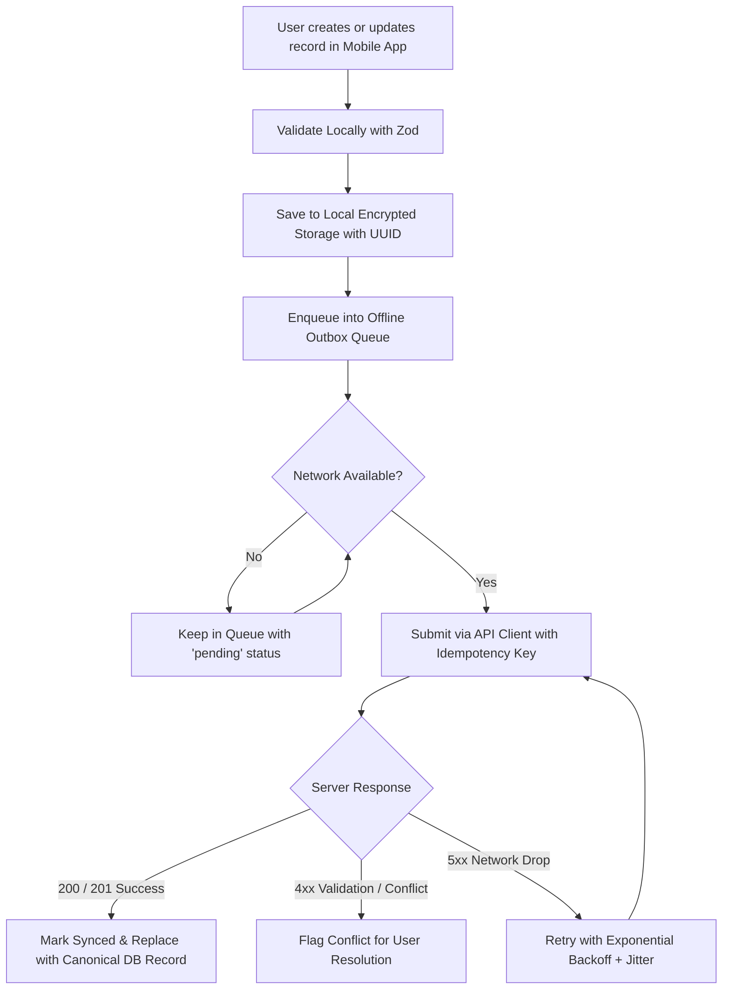

# CultivaNode Mobile App: Full Masterplan
### Single Source of Truth for Mobile Architecture, UX/UI, Feature Modules & Roadmap

**Product Strategy · Mobile Architecture · UX/UI Design System · Feature Modules · Offline-First Workflows · Security & RBAC · Integrations · Release Roadmap**

CultivaNode’s mobile app is the farmer’s everyday operating companion, the service provider’s job-management tool, the field agent’s data-collection platform, and the mobile touchpoint for the wider agricultural intelligence network.

The goal is not to reproduce every web dashboard on a phone. The mobile app makes critical agricultural activities fast and reliable in the field—frequently under weak rural 2G/3G connectivity, direct sunlight, limited battery, and varying levels of digital literacy. More complex administration, bulk ledger management, institutional reporting, and advanced analytics remain web-first.

This masterplan builds on CultivaNode’s established identity: **“Connected intelligence for agriculture”**, with the promise **“Your farm’s working partner.”** It aligns directly with the existing Next.js, Supabase, and Expo/React Native architecture, a shared TypeScript domain model (`@cultivanode/shared`), and a staged rollout focused on South-West Nigeria.

---

## 1. Product Vision & Strategic Objectives

### For Farmers
Manage farms, GPS fields, crop cycles, farm operations, inventory, labour, expenses, weather alerts, and service bookings directly from the field.

### For Service Providers
Receive job requests, manage equipment availability, navigate to farm plots, execute operations, record GPS/photo proof of work, and track escrow settlements.

### For Field Agents
Register farmers, map cadastral farm boundaries, verify NIN/BVN credentials, capture agronomic observations, assist with bookings, and synchronise offline records.

### For Agronomists & Extension Specialists
Review crop health observations, conduct field inspections, issue expert recommendations, and guide farmers with evidence-based agronomic solutions.

### Five Strategic Objectives
1. **Useful from Day One**: A farmer can create a farm, add a field, start a crop cycle, and schedule operations without purchasing IoT hardware or subscribing to financial products.
2. **Resilient Beyond Reliable Internet**: Field observations, tasks, photos, and records can be captured offline and deterministically synchronised later.
3. **Auditable Operational History**: Bookings, work evidence, crop activities, inventory movements, and financial records form a tamper-evident, auditable trail.
4. **Role-Aware, Multi-Tenant Workspaces**: One account can switch between authorised workspaces (e.g. Farmer, Machinery Owner, Agent) with strictly enforced Row-Level Security (RLS).
5. **Composable & Extensible**: Livestock, marketplace commerce, IoT sensors, AI assistance, and partner integrations plug into a shared platform without requiring disconnected apps.

---

## 2. Platform & Technical Architecture

| Layer | Technology | Architecture & Strategy |
| :--- | :--- | :--- |
| **Mobile Client** | Expo SDK + React Native + TypeScript | Android-first optimization (min SDK 24, target SDK 34), fully compatible with iOS. |
| **Backend & Storage** | Supabase (PostgreSQL 15+ & PostGIS) | Row-Level Security on every table, PostGIS SRID 4326 for boundaries, Supabase Storage for encrypted media. |
| **Offline Persistence** | SQLite / Encrypted AsyncStorage + Durable Outbox Queue | Deterministic client UUIDs, idempotency keys, state machines (`pending`, `syncing`, `synced`, `failed`). |
| **Shared Domain** | `@cultivanode/shared` | Monorepo package sharing Zod schemas, types, integer money math, geo utilities, and design tokens. |

### Core Engineering Principles
- **Backend Authoritative Truth**: The database and server-side Edge Functions are the sole authority for permissions, prices, verification status, booking transitions, and financial entries.
- **Row-Level Security (RLS)**: Enforced on all user-accessible tables with `auth_rls_initplan` optimisations. Authenticated client queries must never bypass ownership checks.
- **Integer Kobo Currency**: Monetary values are strictly calculated in integer kobo (`₦1 = 100 kobo`), avoiding floating-point rounding errors.
- **PostGIS Geospatial Coordinates**: Farm boundaries, plots, and GPS check-ins use EPSG:4326 (WGS 84).
- **Replaceable Adapter Architecture**: Weather (NiMet, WeatherAPI, Open-Meteo), Payments (Flutterwave, Paystack), SMS (Termii, Twilio), and Identity (Prembly) are abstract adapters behind domain contracts.
- **Client Security Boundary**: No service-role keys, provider secrets, or elevated credentials are ever bundled into the client build.
- **Offline Safety Controls**: Offline mode cannot authorise payments, elevate user roles, or bypass stock quota locks.

---

## 3. Brand Identity, Design Tokens & UI System

The mobile application strictly implements CultivaNode’s established design tokens defined in [`packages/shared/src/design/tokens.ts`](file:///c:/Users/quadr/Desktop/Cultivanode/cultivanode/packages/shared/src/design/tokens.ts) and [`packages/shared/src/brand.ts`](file:///c:/Users/quadr/Desktop/Cultivanode/cultivanode/packages/shared/src/brand.ts).

### Brand Identity & Logo
- **Product Name**: CultivaNode (capital **N**, never *Cultivanode* or *Cultiva Node*).
- **Tagline**: Connected intelligence for agriculture.
- **Promise**: Your farm's working partner.
- **Logo Mark**: A 40×40 SVG mark featuring a deep green background (`#123D27`), connected nodes in Cyan (`#3BC6D9`), Gold (`#EFC150`), and Green (`#78BB8A`), forming an interconnected 'C'.

### Color Palette (Tokens)
Designed specifically for outdoor visibility on mobile displays under direct sunlight:

| Token | Hex Value | Usage in Mobile App |
| :--- | :--- | :--- |
| **Leaf 800 (Brand Green)** | `#123D27` | Primary brand color, headers, hero cards, splash screen, top nav. |
| **Leaf 700** | `#1A5236` | Secondary green, active icons, interactive headings. |
| **Leaf 600** | `#1F6340` | Primary buttons, success indicators, confirmation badges. |
| **Leaf 50** | `#EDF5EF` | Light green chip fills, active tab highlights. |
| **Node 300 (Brand Cyan)** | `#3BC6D9` | Connected nodes accent, network indicators, sync status. |
| **Harvest 500 (Gold)** | `#C98A14` | Status badges, caution notices, attention highlights. |
| **Harvest 300** | `#EFC150` | User avatar ring, warning pills, pending status. |
| **Harvest 50** | `#FDF7E7` | Warning card background, notice tint. |
| **Soil 500 (Brown)** | `#8A6546` | Secondary accents, agricultural illustrations, soil metrics. |
| **Soil 100** | `#EFE6DC` | Category pill backgrounds, card borders. |
| **Cream (Canvas)** | `#FAF7F0` | Warm primary app background (soft on eyes outdoors). |
| **White** | `#FFFFFF` | Card surfaces, modals, elevated sheets. |
| **Ink** | `#1E2528` | High-contrast body text (passes WCAG AA 4.5:1). |
| **Muted** | `#55605A` | Secondary text, captions, timestamps, inactive icons. |
| **Line** | `#DAD6CC` | Structural borders, card outlines, separators. |
| **Danger** | `#B42318` | Error states, failed sync, urgent crop disease alert. |

### Typography & Hierarchy
- **Font Family**: Plus Jakarta Sans (`'Plus Jakarta Sans Variable'`, system-ui, Roboto, sans-serif). High legibility with full support for Yoruba diacritics (ẹ, ọ, ṣ, à, á, è, é).
- **Text Sizes**:
  - `xs`: 13px (fine print, timestamps)
  - `sm`: 14px (captions, pill tags, badges)
  - `base`: 16px (minimum body text for outdoor legibility)
  - `lg`: 18px (card titles, subheadings)
  - `xl`: 20px (screen section titles)
  - `2xl`: 24px (major titles, hero headlines)
  - `3xl`: 30px (key operational metrics)
- **Minimum Touch Target**: 48 × 48 logical points for all buttons, inputs, and interactive chips.

---

## 4. User Roles & Multi-Tenant Access Model

The mobile client uses a single app shell with role-aware workspaces, eliminating the overhead of multiple fragmented apps while enforcing strict database RLS:

| Role | Core Mobile Responsibilities |
| :--- | :--- |
| **Crop Farmer** | Farm & plot setup, crop cycles, daily tasks, scouting logs, weather, inventory, marketplace buying/selling. |
| **Livestock Farmer** | Herd/flock batches, feeding schedules, health logs, mortality tracking, vet visit records. |
| **Machinery Owner / Operator** | Equipment profile, availability calendar, incoming booking requests, job dispatch, photo evidence of work. |
| **Agricultural Service Provider** | Service catalog, spraying/labour booking requests, work schedules, completion evidence, payment tracking. |
| **Field Agent** | Farmer registration, farm GPS boundary walking, identity verification support, assisted marketplace bookings. |
| **Agronomist / Specialist** | Remote scouting review, disease/pest diagnosis, agronomic advisory notes, field visit reports. |
| **Input Supplier** | Input listings (seeds, fertilizers, crop protection), stock levels, pickup/delivery order management. |
| **Produce Buyer / Off-taker** | Harvest discovery, RFQ requests, contract orders, delivery tracking, escrow confirmation. |

### Workspace Switcher
- Accessible via the profile avatar in the header.
- Instantly reconfigures bottom navigation, actionable dashboards, and query filters.
- Displays the currently active farm or business context.

---

## 5. Navigation & App Shell Structure

Bottom navigation is strictly limited to 5 primary destinations tailored to the active workspace:

```
[Farmer Workspace]       [Provider Workspace]      [Field Agent Workspace]
├── 1. Home / Dashboard   ├── 1. Home / Schedule    ├── 1. Home / Today
├── 2. Farms & Plots      ├── 2. Requests           ├── 2. Farmer Directory
├── 3. Field Tasks        ├── 3. Active Jobs        ├── 3. Map Farm / Plot
├── 4. Market / Shop      ├── 4. Availability       ├── 4. Field Tasks
└── 5. More (Settings)    └── 5. More (Account)     └── 5. More (Sync Centre)
```

### Screen State Standards
Every screen handles 7 distinct lifecycle states:
1. **Loading**: Shimmer skeletons matching the card layout.
2. **Empty**: Explains why data is missing and offers a clear, direct action button.
3. **Error**: User-friendly explanation with a retry trigger.
4. **Offline**: Indicates cached data and disables online-only submissions.
5. **Pending Sync**: Visual indicator (cyan badge) for locally queued records.
6. **Conflict**: Clear side-by-side diff when local and remote versions diverge.
7. **Restricted**: Details required verification tier (Level 1, Level 2, or staff approval).

---

## 6. Comprehensive Module Specification

### Module 1: Welcome, Authentication & Onboarding
- **Phone-First Authentication**: OTP verification via SMS (Termii / Twilio with fallback).
- **Role Selection**: Multi-role assignment (Crop Farmer, Livestock, Equipment Owner, Service Provider, Agent).
- **Resumable Onboarding**: Draft progress is cached locally so phone calls or app restarts don't lose data.
- **Identity & Verification Tiers**:
  - `Level 0`: Registered (can browse and manage personal farm).
  - `Level 1`: NIN Verified (can hire hands, request services).
  - `Level 2`: Verified for Escrow (NIN + BVN + Bank account for receiving payouts).
  - `Level 3`: Vetted Provider / Cooperative partner.

### Module 2: Home Dashboard & Daily Operational Briefing
- **Contextual Farm Selector**: Filter metrics by selected farm and active season.
- **Weather Widget**: Real-time conditions, precipitation risk, and synoptic warnings from NiMet / WeatherAPI.
- **Daily Task Queue**: Urgent operations due today (e.g., Basal fertilizer application, scouting pass).
- **Interactive Quick Tiles**:
  - 👷🏾 **Hire Hands**: Instant access to labour and services.
  - 🚜 **Rent Tractor**: Mechanisation booking and equipment directory.
  - 🧪 **Buy Inputs**: Seeds, agrochemicals, and organic inputs.
  - 📒 **Farm Books**: Operational task calendar, expenses, and crop logs.
- **Offline Sync Status Bar**: Prominent count of records pending server sync.

### Module 3: Farm & Field Geospatial Management
- **Farm Registry**: Name, total area (ha), water source, soil classification, ownership tenure.
- **GPS Boundary Walking**: Walk-the-perimeter polygon capture with real-time GPS accuracy display (meters).
- **State Centroid Fallback**: Automatic approximation when walking is impractical, clearly marked as unverified.
- **Field & Plot Partitioning**: Subdivide farms into named plots linked to soil type and slope.

### Module 4: Crop Management & Agronomy Lifecycle
- **Crop Planning**: Select from vetted templates (Maize, Cassava, Tomato, Cowpea, etc.) with automated stage schedules.
- **Stand Count & Plant Population**: Record total planted population, survival percentage, and mortality causes.
- **Field Calendar & Operations**: Sowing, fertilizer application, weeding, irrigation, scouting, and harvest.
- **Scouting & Pest/Disease Logging**: Capture photo, category (pest, disease, weed, water stress), severity, and notes.
- **Offline Agronomic Queue**: Stores observations in local SQLite/AsyncStorage until connectivity returns.

### Module 5: Field Tasks & Workforce Coordination
- **Task Assignment**: Assign tasks to farm workers or casual labourers with due dates.
- **Proof of Work**: Photo capture and GPS timestamp upon task completion.
- **Supervisor Approvals**: Farm managers approve completed work before costs are logged to Farm Books.

### Module 6: Inventory & Agro-Inputs
- **Input Tracking**: Batches, stock on hand, expiry dates, and unit conversions (bags, litres, kg).
- **Operational Consumption**: Checking off a spraying task automatically deducts chemical stock.
- **Reorder Warnings**: Visual alerts when critical seeds or fertilizers dip below minimum thresholds.

### Module 7: Weather Intelligence & Agronomic Alerts
- **NiMet Integration**: Official synoptic weather warnings, rain probability, and high-wind alerts.
- **Operational Decision Support**: Advises against spraying herbicide if heavy rain is expected within 3 hours.

### Module 8: Services Marketplace & Machine Hire
- **Search & Filter**: Find tractors, boom sprayers, threshers, or manual labor by LGA and availability.
- **Transparent Direct Booking**: Pre-fill farm GPS coordinates, required plot size, and target date.
- **Job Execution Workflow**:
  `Requested → Accepted → Dispatched → In Progress → Completed (with photo evidence) → Confirmed`.

### Module 9: Produce Marketplace & "My Shop" Seller Studio
- **Listing Creation**: Farmers sell harvest; providers list services.
- **Client-Side Photo Compression**: Shrinks images to 1600px JPEG before upload to save mobile data.
- **Inventory Reservation**: Prevents double-selling by locking inventory lots during active checkout.

### Module 10: Farm Books & Financial Tracking
- **Integer Kobo Ledger**: Every expense (seed, labour, diesel) and income (produce sale) recorded in kobo.
- **Crop-Cycle Allocation**: Attribute costs directly to specific plots to calculate true gross margins.
- **Receipt Capture**: Attach photo receipts to financial transactions.

### Module 11: Livestock & Aquaculture (Phase 3)
- **Batch & Animal Records**: Poultry flocks, ruminant herds, and fish ponds.
- **Feed & Health Logs**: Feed conversion tracking, vaccination schedules, and mortality logs.

### Module 12: Offline Sync & Conflict Resolution Engine
- **Local Outbox Queue**: Stores all created observations, task completions, and listings.
- **Exponential Backoff**: Automatic retries with jitter when connectivity is restored.
- **Conflict Handling**: Server state is authoritative for bookings/finances; observational notes merge gracefully.

---

## 7. Offline-First Synchronization Architecture



---

## 8. Staged Implementation & Rollout Roadmap

```
Phase 0: Architecture, Shell & Design Tokens [COMPLETED]
  └── Expo app setup, brand tokens, encrypted session storage, Supabase client, i18n (EN/YO).

Phase 1: Farmer Field Hub & Offline Operations [IN PROGRESS - CURRENT FOCUS]
  ├── Interactive Home Dashboard with live quick tiles (Hire, Rent, Inputs, Farm books).
  ├── Offline Sync Queue for tasks and scouting observations.
  ├── Live Marketplace search, category filtering, and Mobile Seller Studio (+ Sell).
  └── Real data binding to Supabase (farms, plots, crop cycles, operational tasks).

Phase 2: Provider Dispatch, Work Evidence & Bookings
  ├── Machinery owner workspace and job request inbox.
  ├── GPS & Photo proof of work submission.
  └── Provider availability calendar.

Phase 3: Inventory Engine, Farm Books & Livestock
  ├── Local stock deduction upon task completion.
  ├── Income and expense ledger in integer kobo.
  └── Livestock and poultry batch monitoring.

Phase 4: AI Field Assistant & Agronomic Advisory
  ├── Contextual offline/online agronomic advice grounded in farm records.
  └── Image-assisted crop pest & disease classification.

Phase 5: Connected IoT Telematics & Gateway Feeds
  ├── Soil sensor telemetry and threshold alert push notifications.
  └── Cold chain and grain storage monitoring.
```

---

## 9. Definition of Done (DoD) for Mobile Releases

A mobile feature or module is marked **Production-Ready** only when:
1. **Design Token Integrity**: Uses official tokens (`colors.leaf`, `colors.harvest`, `colors.cream`, Plus Jakarta Sans font).
2. **Type Safety**: Passes `npm run typecheck --workspace=@cultivanode/mobile` (`tsc --noEmit`) with zero errors.
3. **Database Security**: All queries respect PostgreSQL RLS; no secrets or service keys exist in client code.
4. **Offline Resilience**: State transitions survive complete app termination and offline reconnection.
5. **Localization**: Fully translated in English and Yorùbá (`en.ts`, `yo.ts`).
6. **Physical Device Verified**: Tested on Android devices under actual 3G / low-bandwidth mobile network conditions.
