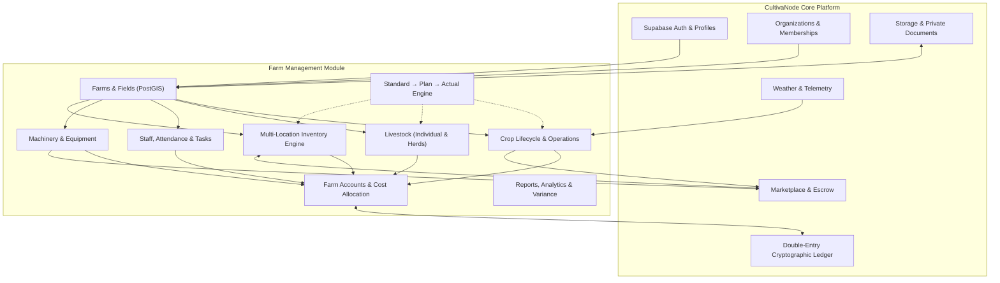

# CultivaNode Farm Management Architecture Report & Blueprint

**Domain:** Farm Management Module  
**Platform:** CultivaNode Agricultural Technology Ecosystem  
**Baseline Date:** 8 October 2026  
**Status:** Architecture Inspection & Execution Blueprint  

---

## 1. Executive Summary & Existing System Inventory

Following the non-negotiable architectural directives, this report audits the existing CultivaNode codebase to establish precise integration boundaries before executing the Farm Management module. The objective is to provide a single, unified digital operating system for the farm without duplicating authentication, payments, ledger accounts, inventory systems, or user profiles.

### 1.1 Existing Codebase Assets Identified

| Layer / Domain | Existing Implementation in Repository | Reuse & Integration Strategy |
|---|---|---|
| **Turborepo Monorepo** | `apps/web` (Next.js 16 App Router), `apps/mobile` (Expo SDK 57 React Native), `packages/shared` (TypeScript, Zod, design tokens, business engines). | Deploy all new domain logic inside `@cultivanode/shared`, web UI inside `apps/web/src/app/[lang]/account/...`, mobile workflows inside `apps/mobile/src/...`. |
| **Identity & Access** | `profiles`, `organizations`, `organization_memberships`, `user_roles`, `admin_roles`, `admin_role_permissions`. Tiered KYC (NIN/BVN). | Strict reuse. All farms, staff, and operations reference existing `profiles(id)` and `organizations(id)`. |
| **Farms & Geography** | `farms` (PostGIS point & polygon, area_ha, state, lga), `plots`, `soil_records`. | Extend `farms` and `plots` with ownership types, irrigation, water sources, and topography. Add dedicated field-level telemetry. |
| **Crop Management** | `crop_cycles`, `crop_cycle_operations`, `crop_scouting_logs`, `crop_input_logs`, `crop_harvest_logs`, `crop_alerts`. | Extend with full Standard → Plan → Actual variance tracking, variety standards, and cost allocation. |
| **Enterprise Subsections** | `farm_livestock`, `farm_workers`, `farm_inventory`, `farm_financial_transactions`, `farm_general_records`. | Substantially upgrade: expand livestock into individual + herd tracking, breeding, health & feeding; convert inventory into a multi-location concurrency-safe ledger; upgrade farm workers into staff attendance & tasks; connect farm books directly to double-entry ledger. |
| **Marketplace & Ledger** | `marketplace_sellers`, `marketplace_listings`, `marketplace_orders`, `marketplace_fulfilments`, `marketplace_payments`, `marketplace_escrows`, `marketplace_ledger_accounts`, `marketplace_journal_entries`. | Deeply integrate: harvest batches flow into marketplace listings; inputs procured on marketplace flow into farm inventory and farm expenses; machinery/labour service requests flow into bookings. |
| **Design System** | `@cultivanode/shared/design/tokens.ts`, `apps/web/src/components/ui/` (Card, Button, Badge, Alert, Input, etc.). WCAG AA contrast, 48px touch targets, Yoruba diacritics. | Maintain consistent UI tokens across all farm management screens. |
| **Offline Sync** | `apps/mobile/src/lib/offline-sync.ts` (queue, local storage, replay). | Extend sync queue to support tasks, attendance, machinery logs, and livestock events with deterministic conflict resolution. |

---

## 2. Core Architectural Principles & Boundaries

### 2.1 The Standard → Plan → Actual Architecture (Non-Negotiable)
Agricultural recommendations in CultivaNode are strictly **advisory**. A farmer's real-world practice must never be overwritten, judged, or blocked because it differs from an agronomic standard.
1. **Standard:** Versioned reference baseline (e.g., IITA GAP maize basal NPK: 200 kg/ha). Immutable historical record.
2. **Farmer Plan:** The farmer's intended operation, budget, or input rate (e.g., 150 kg/ha based on local capital availability).
3. **Actual:** The physical execution recorded from the field (e.g., 160 kg/ha applied on 12 June).
4. **Variance Engine:** Deterministically computes Standard vs Plan, Standard vs Actual, and Plan vs Actual deviations across quantities, costs, dates, and yields.

---

## 3. Database Schema Extensions Blueprint

The database extensions are organized into modular, production-grade PostgreSQL migrations:

1. **`farm_agronomic_standards` & `farm_standard_versions`**:
   - Reusable standards engine supporting planting, fertilisation, spray, livestock feeding, vaccination schedules, machinery benchmarks.
   - Versioning support: historical plans preserve the standard version active at creation.
2. **`farm_fields` & Enhanced `farms`**:
   - Ownership types (`owned`, `leased`, `family`, `partnership`, `community_land`, `managed`).
   - Water source, irrigation systems, soil data, and PostGIS boundary geometries.
3. **`farm_livestock_animals` (Individual) & `farm_livestock_groups` (Herd/Flock)**:
   - RFID/tag tracking, parentage, breed, sex, weight history.
   - Health events (vaccinations, diseases, diagnoses, withdrawal periods, vet costs).
   - Feeding records (feed issue from inventory, FCR calculation).
   - Breeding cycles (mating, AI, pregnancy checks, expected birth, offspring).
   - Production batches (milk, eggs, meat, fish, honey) linking directly to inventory/marketplace.
4. **`farm_staff`, `farm_attendance` & `farm_tasks`**:
   - Staff profiles with roles, departments, employment types, wage rates.
   - Clock-in/clock-out attendance with GPS verification and shift statuses.
   - Unified task management with priority, assignees, scheduled/actual dates, duration, cost, and proof evidence.
5. **`farm_machinery`, `farm_machinery_logs` & `farm_equipment`**:
   - Machinery registry (tractors, implements, harvesters, pumps) with engine hours, serials, and operational statuses.
   - Usage logs tracking operator, field, operation, hours, area covered, fuel consumed, and calculated cost/ha.
   - Maintenance tracking (preventive/corrective, parts, downtime, service intervals).
   - Small equipment inventory (sprayers, scales, PPE, hand tools).
6. **Multi-Location Concurrency-Safe Inventory Engine**:
   - `farm_inventory_locations` (main warehouse, farm store, field store, feed store, cold room).
   - `farm_inventory_items` and `farm_inventory_transactions`.
   - Concurrency-safe PL/pgSQL function `record_farm_inventory_transaction` utilizing `FOR UPDATE` row locking to guarantee zero negative stock and atomic balance transitions.
7. **`farm_budgets`, `farm_budget_lines` & Cost Allocation**:
   - Multilevel cost allocation: Farm → Field → Enterprise → Operation.
   - Budget vs Actual variance calculations.
   - Idempotent integration with existing financial transactions and platform ledger.

---

## 4. Execution Roadmap (Phases 3 to 9)

- **Phase 3 & 4 (Database & Security):** Apply unified PostgreSQL migration containing all domain entities, RLS policies scoped to `can_view_farm()` / `can_edit_farm()`, atomic transaction functions, and audit triggers.
- **Phase 5 (Shared Engines & Core Domains):** Implement TypeScript domain models and business calculators in `packages/shared/src/engines/farm-management/`:
  - `standard-plan-actual.ts`: Variance calculator & versioned standards engine.
  - `inventory-engine.ts`: Multi-location transactional stock manager.
  - `livestock-engine.ts`: FCR, mortality, withdrawal period alerts.
  - `machinery-engine.ts`: Utilisation, cost/ha, maintenance scheduling.
  - `budget-cost-engine.ts`: Enterprise profitability and cost allocation.
- **Phase 6 (Server Actions & Integrations):** Add high-integrity Next.js server actions in `apps/web/src/actions/farm-management.ts` for all farm operations, inventory movements, staff attendance, machinery usage, and livestock records.
- **Phase 7 (Web UI Hub & Workspaces):** Build comprehensive tabbed farm enterprise console in `apps/web/src/app/[lang]/account/farms/[id]/page.tsx` and dedicated navigation routes for Crops, Livestock, Machinery, Staff, Inventory, Accounts, and Calendar.
- **Phase 8 (Mobile Workflows):** Extend mobile offline sync and field screens for mobile attendance, task completion, scouting, and livestock logging.
- **Phase 9 (Verification & Testing):** Execute comprehensive unit, integration, and security test suites.
