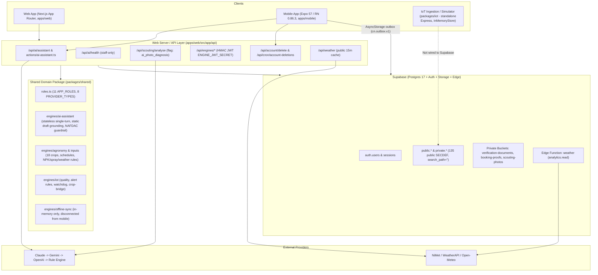

# Batch 03.0 — Baseline Discovery & System Baseline

**Project:** Farm Connect / CultivaNode (`https://www.cultivanode.com`)  
**Repository:** `farmconnect-ux/cultivanode`  
**Branch:** `architecture/batch-03-farm-intelligence-design` (branched from `origin/main` @ `92aa818c896d7f7e2030005b1017b91b2fbc4a83`)  
**Staging Supabase:** `xdbqndgwisshhjqqksbe` (`eu-west-1`, Supabase Free)  
**Production Supabase:** `vqbtnftnxyfaembwgfrk` (untouched)  
**Date:** 2026-11-19

---

## 1. Repository, CI & Deployment Preflight

| Check | Verified State | Evidence |
|---|---|---|
| `origin/main` HEAD | `92aa818c896d7f7e2030005b1017b91b2fbc4a83` | `Merge pull request #11 from farmconnect-ux/stabilization/batch-02-5-mobile-roles-account-deletion` (`2026-11-19T02:31:42Z`) |
| PR #11 | `MERGED` | Head `9e185be86d02652468e29dd774687aa1d03c7526`; Batch 02.5 mobile defect CI run `44443277402` passed (`81` mobile, `21` web, `368` shared, `20` node, `789` pgTAP) |
| `main` CI | `completed` / `success` | Run `44444976804` (`1m19s`) |
| `main` Android build | `in_progress` at preflight | Run `44444976794` |
| Vercel Production deployment | `success` | GitHub deployment `7902374534` (`2026-11-19T02:34:41Z`, `https://cultivanode-4dswhqzg4-quadriolapadegmailcoms-projects.vercel.app`) |
| Staging `schema_migrations` | `74` rows | `59` base + `5` remote-only marketplace + `7` Batch 02.2/02.5/02.6 (`20261118000000`–`20261118060000`) + `3` execution-time duplicates (`20261119005107`, `40`, `53`) |
| Local `supabase/migrations/` | `66` files | Matches `59` base + `7` Batch 02.2/02.5/02.6 |
| Batch 01 Marketplace Reconciliation | **Outstanding** | `origin/security/batch-01-marketplace-hardening` holds `12` post-merge commits (`8ee4f43`..`a8e47dc`) including `5` SQL migrations (`20261117130000`–`180000`) already applied on Staging (`20261117120305`–`153350`). Must be cherry-picked to `main` (not merged wholesale) prior to Production DB push. |

---

## 2. Existing System Architecture (As-Built)

---

## 3. Key Cross-Cutting Observations for Batch 03.0

1. **AI is currently stateless and ungrounded in live farm data:** `/api/ai/assistant` and `actions/ai-assistant.ts` run single-turn Q&A using static in-memory `draft` snippets from `packages/shared/src/engines/agronomy/` (`maize` and `tomato` standards only). None of the 35 farm/plot/crop/soil/telemetry/livestock/financial tables are queried to assemble farm context.
2. **Offline & IoT packages are split:** `apps/mobile/src/lib/outbox.ts` (`cn.outbox.v1`) and `packages/shared/src/engines/offline-sync/` are disconnected; `packages/iot/` defaults to `InMemoryIoTStore` and is not wired to `telemetry_readings`; `sync_approved_iot_to_crop_measurements()` is a no-op stub.
3. **Security baseline is strong on DB, uneven on `/api/engines/*`:** Live Staging has `135/135` `public` `SECURITY DEFINER` functions with `SET search_path = ''`, `0` dynamic SQL, `0` `PUBLIC` ACLs, and hardened `plot_farm_id()` isolation (`20261118060000`). However, `/api/engines/ai/ground` trusts client-supplied `context.farmerId` without matching the JWT `sub`.
4. **Account deletion & audit foundations are mature:** `audit_log` and `admin_actions` are append-only (`private.forbid_change()`), `consents` is append-only with `current_consents`, and 3-phase account deletion preserves financial/device audit records (`device_commands.created_by` nullable `ON DELETE SET NULL`).
