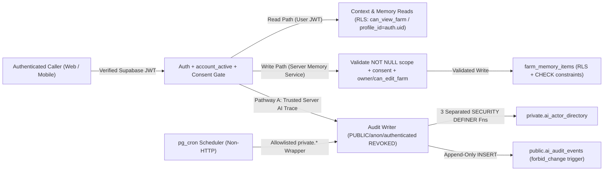

# Batch 03.0 — Security, Threat Model & Governance Design

**Date:** 2026-11-19  
**Status:** Revised for Final Batch 03.0 Security Review  
**Scope:** Threat assessment, read/write security boundaries, two-pathway AI audit trust boundary, `private.ai_actor_directory` privilege enforcement, verifiable `pg_cron` identity, and deletion/consent governance.

---

## 1. Security Boundaries: Read, Write & Audit Pathways

### Mandatory Boundary Controls
1. **Read Path (User-JWT Scoped):** Interactive context and memory reads MUST execute under the caller's verified Supabase JWT (`auth.uid()`, `private.can_view_farm(farm_id)` for `memory_scope = 'farm'`, `profile_id = auth.uid()` for `memory_scope = 'profile'`). Unrestricted `service_role` reads are prohibited on user-initiated AI paths.
2. **Server-Mediated Memory Write Path:** Clients NEVER write directly to `farm_memory_items`. All writes pass through the server-side Memory Write Service validating `auth.uid()`, `private.account_active(auth.uid())`, `'ai_intelligence'` consent (`public.consents`), `NOT NULL memory_scope` constraints, and `private.can_edit_farm(farm_id)` for `'farm'` confirmations. AI-inferred entries remain `source_kind = 'ai_inferred'` and `verification_status = 'proposed'`.
3. **Two-Pathway AI Audit Trust Boundary (No Direct General `authenticated` RPC):**
   - **Why `authenticated` `EXECUTE` is revoked on the general audit writer:** Even if `actor_id` is JWT-bound, allowing ordinary `authenticated` clients to call a general audit-writing RPC via PostgREST would let them fabricate AI model executions, prompt versions, or guardrail passes. Therefore, `REVOKE ALL FROM PUBLIC, anon, authenticated` is enforced on the general audit writer.
   - **Pathway A — Trusted Server-Generated AI Events:** Originate exclusively from CultivaNode's server-side AI orchestration after `supabase.auth.getUser()`, `account_active`, `can_view_farm`/`can_edit_farm`, and Zod allowlist validation. Records actual provider, resolved `model_id`, `prompt_version`, `trace_id`, execution result, and guardrail outcome. Fails closed on validation or audit-write error.
   - **Pathway B — Human Feedback:** Routed through the trusted server API (or a separate feedback-only RPC restricted to `human_outcome in ('accepted','rejected','modified')` on an existing `trace_id` under `can_view_farm`, never accepting `provider`, `model_id`, `prompt_version`, `guardrail_result`, or `actor_kind = 'system'`).
4. **Verifiable PostgreSQL Scheduled-Job Identity (`actor_kind = 'system'`):**
   - Never trusts `current_user` inside `SECURITY DEFINER`, never trusts a client-supplied `system_job_name`, and never assumes `auth.role()`/`auth.uid()` is populated in `pg_cron`.
   - Scheduled tasks are registered in `cron.job` and `private.ai_scheduled_jobs(job_name, system_principal, allowed_event_kinds, is_enabled)`.
   - `pg_cron` invokes a dedicated non-API `private.*` wrapper that verifies `current_setting('request.jwt.claim.role', true)` is NULL/empty (proving non-HTTP execution), validates `job_name` against `private.ai_scheduled_jobs` + `cron.job`, enforces `(job_name, run_window)` idempotency on retries, and records the allowlisted `system_principal`.
5. **Enforceable Privilege Boundaries for `private.ai_actor_directory`:**
   - **Ownership & Schema:** Owned by `postgres`, located in `private` schema (excluded from PostgREST), RLS enabled, all table grants revoked from `PUBLIC, anon, authenticated`.
   - **`service_role` Limitation & Mitigation:** Because Supabase `service_role` has `BYPASSRLS`, general-purpose application `service_role` code must never query `private.ai_actor_directory` directly. Access is encapsulated behind **3 separated `SECURITY DEFINER` functions** (`owner: postgres`, `SET search_path = ''`, fully qualified refs, `REVOKE ALL FROM PUBLIC, anon, authenticated`, `GRANT EXECUTE TO service_role` only):
     - `private.resolve_or_create_ai_actor(p_profile_id)` (active mappings only; rejects `deleted_at IS NOT NULL`).
     - `private.anonymise_ai_actor(p_profile_id)` (account-deletion only; sets `profile_id = NULL, deleted_at = COALESCE(deleted_at, now())`; idempotent; cannot create or reactivate).
     - `private.lookup_ai_actor_subject(p_actor_subject_id)` (single-row compliance lookup; no bulk enumeration).
   - Anonymisation is audited once in `public.audit_log` without mutating `public.ai_audit_events`.

---

## 2. Explicit 13-Threat Assessment & Mitigations

| # | Threat | Vector / Existing Risk | Required Control & Mitigation |
|---|---|---|---|
| 1 | **Cross-farm data leakage** | Passing another farm's `farm_id` or `plot_id` in context/memory requests | Context & `scope='farm'` memory queries run under user JWT + `private.can_view_farm(farm_id)`; `scope='profile'` cannot hold `farm_id` (`NOT NULL memory_scope` + `CHECK` constraint). |
| 2 | **Cross-organisation data leakage** | Org member reading farms outside their `organization_id` | `private.can_view_farm(farm_id)` restricts org access to `public.org_role(f.organization_id) IS NOT NULL`; org removal revokes access immediately. |
| 3 | **Insecure Direct Object Reference (IDOR)** | Client passing arbitrary `farmerId` (`/api/engines/ai/ground`), `actor_id`, or `trace_id` | Derive actor from verified server `auth.getUser()` / JWT; bind `farm_id` to `can_view_farm(farm_id)`. |
| 4 | **RLS bypass & audit fabrication** | `authenticated` calling audit RPC directly or `service_role` enumerating `ai_actor_directory` | Revoke `PUBLIC, anon, authenticated` from general audit writer; encapsulate `private.ai_actor_directory` behind 3 separated `SECURITY DEFINER` functions. |
| 5 | **Prompt injection (uploads & external docs)** | Malicious instructions in notes, photo OCR, or external PDFs | Delimit retrieved records/snippets as untrusted data; validate structured JSON outputs with Zod. |
| 6 | **Malicious or misleading sensor inputs** | Faulty/spoofed IoT readings or unvalidated `machinery_telemetry` | Reject `'faulty'`/`'quarantined'` readings; flag non-monotonic `machinery_telemetry.engine_hours` as `conflicting`/`unverified_provisional`; never override verified lab soil chemistry. |
| 7 | **AI-generated false facts** | LLM inventing soil pH, yields, or treating missing/stale data as current | Enforce 8-domain precedence, `soil_test_age_days` formula, and 7 context states; missing is never `0`. |
| 8 | **Unauthorised memory modification** | Direct client writes or AI self-promoting to `'confirmed'` | Server-mediated Memory Write Service + `can_edit_farm(farm_id)` for farm confirmations + `profile_id = auth.uid()` for profile preferences. |
| 9 | **Model hallucination** | Recommending banned pesticides (`aldrin`, `paraquat`, etc.) | Run `checkChemicalSafetyGuardrails()` across **all** output fields (`summary`, `likely`, `actions`, chat text) + include `aldrin`; use immutable validated prompt versions (`ADR-006`). |
| 10 | **Sensitive information disclosure** | Enumeration of `ai_actor_directory` or PII/keys in prompts/audit | Keep `ai_actor_directory` in `private` schema behind 3 single-purpose functions; redact PII before prompt assembly; never store tokens, keys, or raw `imageBase64` in `ai_audit_events`. |
| 11 | **Insecure audit records & job spoofing** | Spoofing `system_job_name`, mutating audit rows, or re-identifying deleted users | `pg_cron` non-HTTP wrapper + `private.ai_scheduled_jobs` allowlist; `private.forbid_change()` on `ai_audit_events`; deleted `ai_actor_directory` mappings cannot be reactivated. |
| 12 | **Unauthorised AI actions** | Autonomous `device_commands` or financial mutations | Batch 03.0 is advisory-only; future Batch 03.4 actions require `ai_action_proposals` HITL approval + `device_commands` RLS policies. |
| 13 | **Data deletion & retention conflicts** | Account deletion vs. append-only `ai_audit_events` and surviving farm knowledge | `execute_account_deletion` deletes `scope='profile'` memory, nulls `created_by`/`confirmed_by`/`updated_by` on surviving org `scope='farm'` memory (preserving `farm_id` knowledge), and calls `private.anonymise_ai_actor()` without mutating `ai_audit_events`. |
