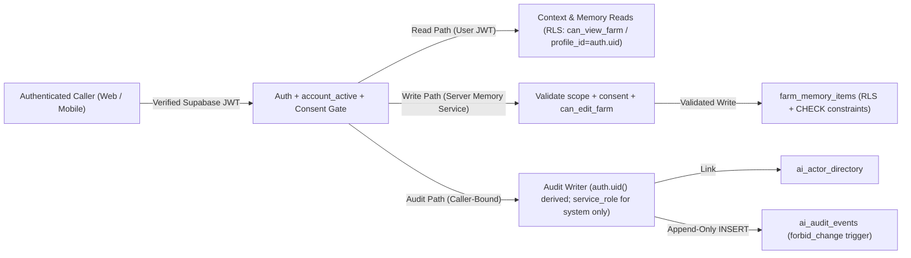

# Batch 03.0 — Security, Threat Model & Governance Design

**Date:** 2026-11-19  
**Status:** Revised for Batch 03.0 Review Findings 1, 2, 3 & 6  
**Scope:** Threat assessment, read/write security boundaries, caller-bound audit writer contract, and deletion/consent governance for the Farm Intelligence Engine (FIE).

---

## 1. Security Boundaries: Read Path vs. Write Path

### Mandatory Boundary Controls
1. **Read Path (User-JWT Scoped):** Interactive context and memory reads MUST execute under the caller's verified Supabase JWT so `auth.uid()`, `private.can_view_farm(farm_id)` (for `memory_scope = 'farm'`), and `profile_id = auth.uid()` (for `memory_scope = 'profile'`) enforce RLS natively. Unrestricted `service_role` reads are prohibited on user-initiated AI paths.
2. **Server-Mediated Memory Write Path:** Clients NEVER write directly to `farm_memory_items`. All writes pass through a server-side Memory Write Service that verifies `auth.uid()`, `private.account_active(auth.uid())`, `'ai_intelligence'` consent in `public.consents` (`current_consents`), valid `memory_scope` (`'farm'` vs `'profile'`), and `private.can_edit_farm(farm_id)` for `'farm'` confirmations/edits. AI-inferred entries are restricted to `source_kind = 'ai_inferred'` and `verification_status = 'proposed'`.
3. **Caller-Bound Audit Writer Contract:**
   - **Trusted inputs:** Verified JWT (`auth.uid()`) for `actor_kind = 'human'`; `service_role` context + `system_job_name` for `actor_kind = 'system'`.
   - **Rejected conditions:** Unauthenticated calls (`auth.uid() IS NULL` under `authenticated`), `authenticated` callers attempting `actor_kind = 'system'`, client-supplied `actor_id` overrides, `farm_id` failing `private.can_view_farm(farm_id)`, or `context_record_refs` referencing another farm.
   - **Grants:** `REVOKE ALL FROM PUBLIC, anon`; `GRANT EXECUTE TO authenticated, service_role` with strict internal role branching (`authenticated` → human-only bound to `auth.uid()`; `service_role` → system-only).
   - **Error handling:** Audit write failures emit critical structured logs and block state-changing/actionable flows rather than silently dropping security events.
4. **Immutable Audit vs. Account Deletion:** `ai_audit_events` is strictly append-only (`private.forbid_change()`). Identity resolution lives in mutable `ai_actor_directory` (`actor_subject_id ↔ profile_id`), which sets `profile_id = NULL, deleted_at = now()` during `execute_account_deletion` while leaving `ai_audit_events` untouched. Deletion/anonymisation events are recorded in `public.audit_log`.

---

## 2. Explicit 13-Threat Assessment & Mitigations

| # | Threat | Vector / Existing Risk | Required Control & Mitigation |
|---|---|---|---|
| 1 | **Cross-farm data leakage** | Passing another farm's `farm_id` or `plot_id` in context/memory requests | Context & `scope='farm'` memory queries run under user JWT + `private.can_view_farm(farm_id)`; `scope='profile'` cannot hold `farm_id` (`CHECK` constraint). |
| 2 | **Cross-organisation data leakage** | Org member reading farms outside their `organization_id` | `private.can_view_farm(farm_id)` restricts org access to `public.org_role(f.organization_id) IS NOT NULL`; org removal revokes access immediately. |
| 3 | **Insecure Direct Object Reference (IDOR)** | Client passing arbitrary `farmerId` (`/api/engines/ai/ground`), `actor_id`, or `memory_id` | Derive `actor_id` exclusively from `auth.uid()`; bind `farm_id` to `can_view_farm(farm_id)`. |
| 4 | **RLS bypass via privileged functions** | Privileged writer or helper exposing cross-farm reads/writes | Audit writer is `INSERT`-only, enforces `can_view_farm(farm_id)` for human callers, uses `SET search_path = ''`, and revokes `PUBLIC, anon`. |
| 5 | **Prompt injection (uploads & external docs)** | Malicious instructions in notes, photo OCR, or external PDFs | Delimit retrieved records/snippets as untrusted data; validate structured JSON outputs with Zod. |
| 6 | **Malicious or misleading sensor inputs** | Faulty/spoofed IoT readings triggering false advice | Reject `'faulty'`/`'quarantined'` readings; weight `'suspicious'` lower; never let sensor readings override verified lab soil chemistry. |
| 7 | **AI-generated false facts** | LLM inventing soil pH, yields, or unverified practices | Enforce domain-specific precedence & 7 context states; keep AI outputs `proposed`/`unverified_provisional` until human confirmation. |
| 8 | **Unauthorised memory modification** | Direct client writes or AI self-promoting to `'confirmed'` | Server-mediated Memory Write Service + `can_edit_farm(farm_id)` for farm confirmations + `profile_id = auth.uid()` for profile preferences. |
| 9 | **Model hallucination** | Recommending banned pesticides (`aldrin`, `paraquat`, etc.) | Run `checkChemicalSafetyGuardrails()` across **all** output fields (`summary`, `likely`, `actions`, chat text) + include `aldrin`; ground on `published` `farm_agronomic_standards`. |
| 10 | **Sensitive information disclosure** | PII, phone numbers, bank details, or API keys in prompts/audit | Redact PII before prompt assembly; never store tokens, keys, or raw `imageBase64` in `ai_audit_events`. |
| 11 | **Insecure audit records** | Tampering with or deleting AI decision history | `ai_audit_events` protected by `private.forbid_change()`; readable only via `can_view_farm(farm_id)` or staff `has_permission('audit.read')`. |
| 12 | **Unauthorised AI actions** | Autonomous `device_commands` or financial mutations | Batch 03.0 is advisory-only; future Batch 03.4 actions require `ai_action_proposals` HITL approval + `device_commands` RLS policies. |
| 13 | **Data deletion & retention conflicts** | Account deletion vs. append-only `ai_audit_events` | `execute_account_deletion` deletes `scope='profile'` memory, nulls `created_by`/`confirmed_by` on surviving org `scope='farm'` memory, and unlinks `ai_actor_directory.profile_id` without mutating `ai_audit_events`. |
