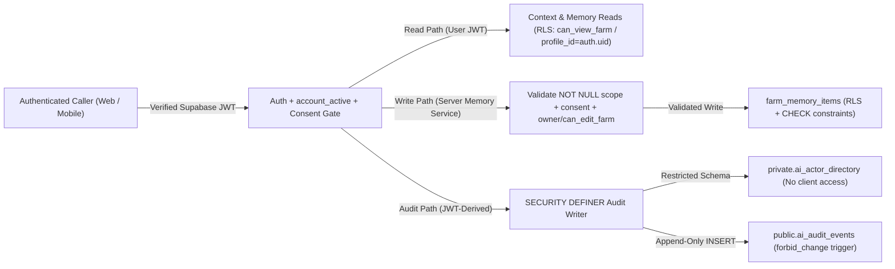

# Batch 03.0 — Security, Threat Model & Governance Design

**Date:** 2026-11-19  
**Status:** Revised for Batch 03.0 Identity & Memory Controls  
**Scope:** Threat assessment, read/write security boundaries, `SECURITY DEFINER` audit-writer contract, `private.ai_actor_directory` protection, and deletion/consent governance for the Farm Intelligence Engine (FIE).

---

## 1. Security Boundaries: Read Path vs. Write Path

### Mandatory Boundary Controls
1. **Read Path (User-JWT Scoped):** Interactive context and memory reads MUST execute under the caller's verified Supabase JWT so `auth.uid()`, `private.can_view_farm(farm_id)` (for `memory_scope = 'farm'`), and `profile_id = auth.uid()` (for `memory_scope = 'profile'`) enforce RLS natively. Unrestricted `service_role` reads are prohibited on user-initiated AI paths.
2. **Server-Mediated Memory Write Path:** Clients NEVER write directly to `farm_memory_items`. All writes pass through a server-side Memory Write Service that verifies `auth.uid()`, `private.account_active(auth.uid())`, `'ai_intelligence'` consent in `public.consents` (`current_consents`), non-null `memory_scope` rules (`'farm'` requires `farm_id NOT NULL` & `profile_id IS NULL`; `'profile'` requires `farm_id IS NULL`, `profile_id = auth.uid()`, `category = 'preference'`), and `private.can_edit_farm(farm_id)` for `'farm'` confirmations/edits. AI-inferred entries are restricted to `source_kind = 'ai_inferred'` and `verification_status = 'proposed'`.
3. **Trusted Caller Validation Inside `SECURITY DEFINER` Audit Writer:**
   - **No `current_user` trust:** Because `SECURITY DEFINER` executes as its owner (`postgres`), `current_user` is NEVER treated as proof of the caller's identity or role.
   - **Human-initiated (`actor_kind = 'human'`):** Validates `auth.role() = 'authenticated'` and `auth.uid() IS NOT NULL` from verified JWT claims; verifies `private.account_active(auth.uid())`; binds `farm_id` via `private.can_view_farm(farm_id)` (and `can_edit_farm` for edit/confirmation events). Rejects missing/invalid JWT claims, client-supplied `actor_id`/`profile_id`, and any attempt by `authenticated` to pass `actor_kind = 'system'`.
   - **System-generated (`actor_kind = 'system'`):** Permitted **only** when `auth.role() = 'service_role'` (or internal `postgres` scheduled job) with an allowlisted `system_job_name` / `system_principal`.
   - **Boundaries & Grants:** `SET search_path = ''`, explicit schema qualification, `REVOKE ALL FROM PUBLIC, anon`, `GRANT EXECUTE TO authenticated, service_role`, `INSERT`-only (cannot read or mutate unrelated farm data). Security-critical audit failures surface errors loudly rather than being silently discarded.
4. **Protection of `private.ai_actor_directory`:**
   - **Data sensitivity & minimisation:** Maps opaque `actor_subject_id uuid` ↔ `profile_id uuid` (nullable, `ON DELETE SET NULL`) + `actor_kind`, `system_principal`, `created_at`, `deleted_at`. No names, emails, or phone numbers are stored.
   - **Schema & Access Restrictions:** Placed in the **`private` schema** (excluded from PostgREST/Data API). RLS enabled; `REVOKE ALL FROM PUBLIC, anon, authenticated`; `service_role` access is narrowly scoped in server architecture to account deletion and internal audit-resolution workflows only.
   - **Permitted Operations & Non-Reactivation:** Only the trusted Audit Writer may create/resolve active mappings (`deleted_at IS NULL`); only `execute_account_deletion` (`service_role`) may anonymise a mapping (`profile_id = NULL, deleted_at = COALESCE(deleted_at, now())`, idempotent). Ordinary updates/deletes and reactivating a deleted mapping (`deleted_at IS NOT NULL`) are prohibited by constraints/triggers. Anonymisation is audited once in `public.audit_log` (avoiding recursive `ai_audit_events` writes).

---

## 2. Explicit 13-Threat Assessment & Mitigations

| # | Threat | Vector / Existing Risk | Required Control & Mitigation |
|---|---|---|---|
| 1 | **Cross-farm data leakage** | Passing another farm's `farm_id` or `plot_id` in context/memory requests | Context & `scope='farm'` memory queries run under user JWT + `private.can_view_farm(farm_id)`; `scope='profile'` cannot hold `farm_id` (`NOT NULL memory_scope` + `CHECK` constraint). |
| 2 | **Cross-organisation data leakage** | Org member reading farms outside their `organization_id` | `private.can_view_farm(farm_id)` restricts org access to `public.org_role(f.organization_id) IS NOT NULL`; org removal revokes access immediately. |
| 3 | **Insecure Direct Object Reference (IDOR)** | Client passing arbitrary `farmerId` (`/api/engines/ai/ground`), `actor_id`, or `memory_id` | Derive `actor_id` exclusively from `auth.uid()` inside `SECURITY DEFINER` / server layer; bind `farm_id` to `can_view_farm(farm_id)`. |
| 4 | **RLS bypass via privileged functions** | Privileged writer or helper exposing cross-farm reads/writes or directory enumeration | Audit writer is `INSERT`-only, enforces `can_view_farm(farm_id)`, uses `SET search_path = ''`, and revokes `PUBLIC, anon`; `private.ai_actor_directory` is inaccessible to PostgREST/clients. |
| 5 | **Prompt injection (uploads & external docs)** | Malicious instructions in notes, photo OCR, or external PDFs | Delimit retrieved records/snippets as untrusted data; validate structured JSON outputs with Zod. |
| 6 | **Malicious or misleading sensor inputs** | Faulty/spoofed IoT readings triggering false advice | Reject `'faulty'`/`'quarantined'` readings; weight `'suspicious'` lower; never let sensor readings override verified lab soil chemistry. |
| 7 | **AI-generated false facts** | LLM inventing soil pH, yields, or unverified practices | Enforce 8-domain precedence & 7 context states; keep AI outputs `proposed`/`unverified_provisional` until human confirmation. |
| 8 | **Unauthorised memory modification** | Direct client writes or AI self-promoting to `'confirmed'` | Server-mediated Memory Write Service + `can_edit_farm(farm_id)` for farm confirmations + `profile_id = auth.uid()` for profile preferences. |
| 9 | **Model hallucination** | Recommending banned pesticides (`aldrin`, `paraquat`, etc.) | Run `checkChemicalSafetyGuardrails()` across **all** output fields (`summary`, `likely`, `actions`, chat text) + include `aldrin`; ground on `published` `farm_agronomic_standards`. |
| 10 | **Sensitive information disclosure** | Enumeration of `ai_actor_directory` or PII/keys in prompts/audit | Keep `ai_actor_directory` in `private` schema; redact PII before prompt assembly; never store tokens, keys, or raw `imageBase64` in `ai_audit_events`. |
| 11 | **Insecure audit records** | Tampering with or deleting AI decision history, or re-identifying deleted users | `ai_audit_events` protected by `private.forbid_change()`; readable only via `can_view_farm(farm_id)` or staff `has_permission('audit.read')`; deleted `ai_actor_directory` mappings cannot be reactivated. |
| 12 | **Unauthorised AI actions** | Autonomous `device_commands` or financial mutations | Batch 03.0 is advisory-only; future Batch 03.4 actions require `ai_action_proposals` HITL approval + `device_commands` RLS policies. |
| 13 | **Data deletion & retention conflicts** | Account deletion vs. append-only `ai_audit_events` and surviving farm knowledge | `execute_account_deletion` deletes `scope='profile'` memory, nulls `created_by`/`confirmed_by`/`updated_by` on surviving org `scope='farm'` memory (preserving `farm_id` knowledge), and idempotently unlinks `private.ai_actor_directory.profile_id = NULL` without mutating `ai_audit_events`. |
