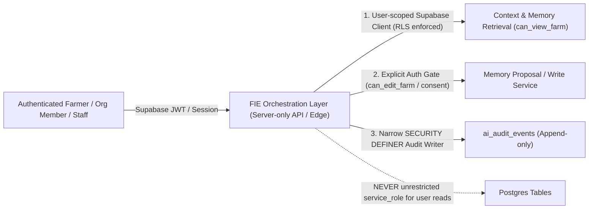

# Batch 03.0 — Security, Threat Model & Governance Design

**Date:** 2026-11-19  
**Scope:** Threat assessment and security boundary specification for the Farm Intelligence Engine (FIE), Live Farm Context Retrieval, Persistent Farm Memory, and AI Audit Register.

---

## 1. Security Boundary: AI Orchestration Layer ↔ Supabase

### Mandatory Boundary Rules
1. **Zero Unrestricted `service_role` Context Reads:** User-initiated FIE requests MUST query farm tables, context views, and memory records using the **caller's authenticated Supabase JWT** (so `auth.uid()` and `private.can_view_farm(farm_id)` enforce RLS).
2. **Authoritative Identity Binding:** `actor_id` / `farmer_id` MUST always be derived from verified `auth.getUser()`, never from request body parameters (remediating the existing gap in `/api/engines/ai/ground`).
3. **Consent & Active-Account Gate:** Proactive monitoring and persistent memory retention require `private.account_active(auth.uid())` and an explicit `ai_intelligence` consent record in `public.consents` (`current_consents`).
4. **Append-Only Audit via Narrow `SECURITY DEFINER`:** `ai_audit_events` is written only by a dedicated `SECURITY DEFINER` function (`SET search_path = ''`, `REVOKE ALL FROM public, anon, authenticated` or caller-bound insert) protected by `private.forbid_change()`.

---

## 2. Explicit 13-Threat Assessment & Mitigations

| # | Threat | Vector / Existing Risk | Required Control & Mitigation |
|---|---|---|---|
| 1 | **Cross-farm data leakage** | Passing another farm's `farm_id` or `plot_id` in AI context requests | All context/memory queries run under user JWT + `private.can_view_farm(farm_id)` RLS; `plot_farm_id()` hardened (`20261118060000`). |
| 2 | **Cross-organisation data leakage** | Org member reading farms outside their `organization_id` | `private.can_view_farm(farm_id)` restricts org access to `public.org_role(f.organization_id) is not null`; memory tables carry `farm_id` and inherit `can_view_farm(farm_id)`. |
| 3 | **Insecure Direct Object Reference (IDOR)** | Client passing arbitrary `farmerId` (as in `/api/engines/ai/ground`), `observation_id`, or `memory_id` | Bind `actor_id` to `auth.uid()`, bind `farm_id` to `can_view_farm(farm_id)`, and scope `scouting_photos` / `crop_observations` via user-scoped RLS. |
| 4 | **RLS bypass via privileged functions** | `service_role` or `SECURITY DEFINER` helper exposing farm data without auth | Prohibit `service_role` reads in user AI paths; require `SET search_path = ''`, explicit `REVOKE FROM PUBLIC, anon`, and `private.can_view_farm`/`can_edit_farm` inside any helper. |
| 5 | **Prompt injection (uploads & external docs)** | Malicious instructions in farmer notes, photo OCR, or external agronomy PDFs | Wrap all retrieved farm records and external snippets in strict XML/delimiter data blocks; strip control prompts; never pass raw user/sensor text as system instructions; enforce Zod/JSON output schemas. |
| 6 | **Malicious or misleading sensor inputs** | Spoofed/faulty IoT readings triggering false irrigation or alerts | `quality-checker.ts` rejects sentinels (`-999`, `NaN`) and flags spikes as `'suspicious'`; FIE excludes `'faulty'`/`'quarantined'` readings, weights `'suspicious'` lower, and requires persistence windows before alerting. |
| 7 | **AI-generated false facts** | LLM inventing soil pH, yield, or unverified agronomy advice | Separate `source_kind` (`farmer_reported`, `staff_verified`, `sensor`, `external_weather`, `ai_inferred`); AI summaries/inferences NEVER overwrite canonical farm tables or become `'verified'` memory without human confirmation. |
| 8 | **Unauthorised memory modification** | Worker or external user altering confirmed farm facts/preferences | Writes to `farm_memory_items` require `private.can_edit_farm(farm_id)` (or self-owned `preference` memory); AI can only create `status = 'proposed'`/`'unverified'` entries, never overwrite `'confirmed'` records. |
| 9 | **Model hallucination** | Recommending banned pesticides or wrong rates | Mandatory post-generation `checkChemicalSafetyGuardrails()` across **all** output fields (`summary`, `likely`, `actions` — fixing `ai-vision.ts:158` partial replacement + adding `aldrin`); ground against `status = 'published'` `farm_agronomic_standards`. |
| 10 | **Sensitive information disclosure** | PII, phone numbers, financial balances, or API keys in prompts/logs | Redact PII (phone, email, bank details) before LLM prompt assembly; never log `Authorization` headers, API keys, or raw `imageBase64` in `ai_audit_events`. |
| 11 | **Insecure audit records** | Tampering with or deleting AI decision history | `ai_audit_events` protected by `private.forbid_change()` (`BEFORE UPDATE OR DELETE` trigger); readable only by farm `can_view_farm(farm_id)` (for own farm trace) or staff `has_permission('audit.read')`. |
| 12 | **Unauthorised AI actions** | AI issuing `device_commands` or financial/booking mutations autonomously | Batch 03.0 is advisory-only. Future Batch 03.x actions require an explicit `ai_action_proposals` HITL queue, `can_edit_farm(farm_id)` approval, rate/budget caps, and `device_commands` RLS policies. |
| 13 | **Data deletion & retention conflicts** | `execute_account_deletion` deleting user while AI memory/audit remains | Scope memory by `farm_id` (anonymize `actor_id` / delete personal `preference` memory on account deletion while preserving anonymized `ai_audit_events` for safety/agronomic traceability, matching `device_commands.created_by` pattern). |
