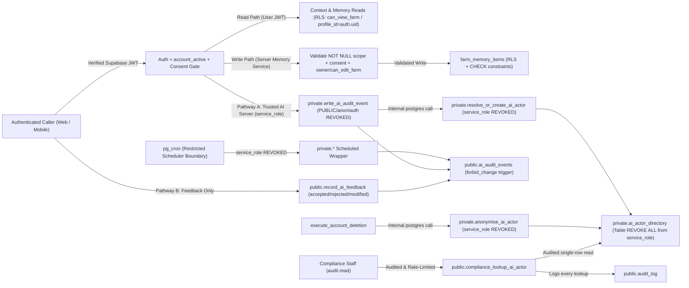

# Batch 03.0 — Security, Threat Model & Governance Design

**Date:** 2026-11-19  
**Status:** Revised for PR #12 Independent Review Remediation  
**Scope:** Threat assessment, read/write security boundaries, trusted AI audit-writer contract, `private.ai_actor_directory` privilege enforcement & audited compliance lookup, verifiable `pg_cron` identity, and deletion/consent governance.

---

## 1. Security Boundaries: Read, Write & Audit Pathways

### Mandatory Boundary Controls
1. **Read Path (User-JWT Scoped):** Interactive context and memory reads MUST execute under the caller's verified Supabase JWT (`auth.uid()`, `private.can_view_farm(farm_id)` for `memory_scope = 'farm'`, `profile_id = auth.uid()` for `memory_scope = 'profile'`). Unrestricted `service_role` reads are prohibited on user-initiated AI paths.
2. **Server-Mediated Memory Write Path:** Clients NEVER write directly to `farm_memory_items`. All writes pass through the server-side Memory Write Service validating `auth.uid()`, `private.account_active(auth.uid())`, `'ai_intelligence'` consent (`public.consents`), `NOT NULL memory_scope` constraints, and `private.can_edit_farm(farm_id)` for `'farm'` confirmations. AI-inferred entries remain `source_kind = 'ai_inferred'` and `verification_status = 'proposed'`.
3. **Trusted AI Audit-Writer & Human Feedback Contract (`ADR-005`):**
   - **Why `authenticated` `EXECUTE` is revoked on `private.write_ai_audit_event`:** Prevents clients from fabricating AI executions, model IDs, or guardrail passes via PostgREST RPC.
   - **Pathway A — Trusted Server-Side AI Orchestration (`service_role`):** Centralised strictly in `apps/web/src/lib/ai-audit.ts` (prohibiting direct calls from unrelated routes/clients via code review and lint rules). Invoked only after `auth.getUser()`, `account_active`, `can_view_farm`/`can_edit_farm`, and Zod allowlist validation; records verified actor, `trace_id`, provider, resolved `model_id`, immutable `prompt_version`, execution outcome, and `guardrail_result` (no secrets, raw images, or unnecessary PII). Fails closed on validation or audit-write error.
   - **Explicit `service_role` Limitation:** Because `apps/web` shares `SUPABASE_SECRET_KEY` (`service_role`), isolating `private.write_ai_audit_event` invocations inside `apps/web/src/lib/ai-audit.ts` is an **application-architecture and code-review boundary**, NOT an independently enforced database identity boundary. A dedicated `ai_orchestrator` Postgres role remains a future option if AI workloads are separated from the Next.js server.
   - **Pathway B — Human Feedback (`public.record_ai_feedback`):** `GRANT EXECUTE TO authenticated` (`PUBLIC, anon` revoked). Derives `auth.uid()`, checks `account_active` and `can_view_farm(farm_id)` for an existing `trace_id`, restricts `p_outcome IN ('accepted', 'rejected', 'modified')`, and cannot alter `provider`, `model_id`, `prompt_version`, `guardrail_result`, `actor_kind = 'system'`, or original execution outcome.
4. **Scheduled-Job Identity Assurance Model (`actor_kind = 'system'`):**
   - **Status:** *"Restricted privileged scheduler execution boundary, pending dedicated scheduler identity verification."*
   - **A. Proposed Controls:** Scheduled wrappers in `private.*` enforce `REVOKE ALL FROM PUBLIC, anon, authenticated, service_role`; job registration in `cron.job` (`pg_cron` `1.6.4`) + `private.ai_scheduled_jobs` is restricted to `postgres`; the wrapper validates `job_name`, `allowed_event_kinds`, `is_enabled = true`, and `(job_name, run_window)` idempotency, and rejects `anon`/`authenticated`/`authenticator`/`service_role`.
   - **B. Remaining Identity Limitation:** Manually initiated SQL sessions using `postgres` share the same role as `pg_cron`; PostgreSQL cannot distinguish those sessions solely by role.
   - **C. Batch 03.3 Verification:** Test creating a dedicated non-`BYPASSRLS` role (`cultivanode_scheduler`) via `cron.alter_job` on `CultivaNode-Staging`. If unsupported, document `postgres`-only `private.*` wrappers (`service_role` revoked) + allowlist + idempotency as the strongest feasible boundary.
5. **Enforceable Privilege Boundaries for `private.ai_actor_directory`:**
   - **Table & Schema:** Owned by `postgres` in `private` schema (not exposed by PostgREST), RLS enabled, **`REVOKE ALL ON TABLE private.ai_actor_directory FROM PUBLIC, anon, authenticated, service_role`**. Because `service_role` has `rolsuper = false` and is not table owner, `BYPASSRLS` does not override table-level `REVOKE`.
   - **Internal-Only Functions (`service_role` REVOKED):** `private.resolve_or_create_ai_actor(p_profile_id)` (internal to `postgres`-owned audit writer), `private.anonymise_ai_actor(p_profile_id)` (internal to `execute_account_deletion`), and `private.lookup_ai_actor_subject(p_actor_subject_id)` (**revoked from `service_role`, `authenticated`, `anon`, `PUBLIC`** to block `service_role` bulk enumeration).
   - **Audited Compliance Lookup (`public.compliance_lookup_ai_actor(p_actor_subject_id, p_purpose)`):** `GRANT EXECUTE TO authenticated` (`PUBLIC, anon` revoked). Enforces `public.has_permission('audit.read')`, `private.account_active(auth.uid())`, non-empty `p_purpose`, single-subject return only, mandatory `public.audit_log` recording for every attempt, and a per-actor query-volume rate threshold over recent `audit_log` lookups.

---

## 2. Explicit 13-Threat Assessment & Mitigations

| # | Threat | Vector / Existing Risk | Required Control & Mitigation |
|---|---|---|---|
| 1 | **Cross-farm data leakage** | Passing another farm's `farm_id` or `plot_id` in context/memory/grounding requests | Context & `scope='farm'` memory queries run under user JWT + `private.can_view_farm(farm_id)`; `/api/engines/ai/ground` bound to auth context in Batch 03.1; `scope='profile'` cannot hold `farm_id`. |
| 2 | **Cross-organisation data leakage** | Org member reading farms outside their `organization_id` | `private.can_view_farm(farm_id)` restricts org access to `public.org_role(f.organization_id) IS NOT NULL`; org removal revokes access immediately. |
| 3 | **Insecure Direct Object Reference (IDOR)** | Client passing arbitrary `farmerId` (`/api/engines/ai/ground`), `actor_id`, or `trace_id` | Derive actor from verified server `auth.getUser()` / JWT; bind `farm_id` to `can_view_farm(farm_id)`. |
| 4 | **RLS bypass & directory enumeration** | `authenticated` calling audit RPC or `service_role` enumerating `ai_actor_directory` | Revoke `PUBLIC, anon, authenticated` from `write_ai_audit_event`; revoke `service_role` table & `lookup_ai_actor_subject` privileges; require `compliance_lookup_ai_actor` (`audit.read`, audited, rate-limited). |
| 5 | **Prompt injection (uploads & external docs)** | Malicious instructions in notes, photo OCR, or external PDFs | Delimit retrieved records/snippets as untrusted data; validate structured JSON outputs with Zod. |
| 6 | **Malicious or misleading sensor inputs** | Faulty/spoofed IoT readings or unvalidated `machinery_telemetry` | Reject `'faulty'`/`'quarantined'` readings; flag non-monotonic `machinery_telemetry.engine_hours` as `conflicting`/`unverified_provisional`; never override verified lab soil chemistry. |
| 7 | **AI-generated false facts** | LLM inventing soil pH, yields, or treating missing/stale data as current | Enforce 8-domain precedence, `soil_test_age_days` formula (with agronomist-approved validity), and 7 context states; missing is never `0`. |
| 8 | **Unauthorised memory modification** | Direct client writes or AI self-promoting to `'confirmed'` | Server-mediated Memory Write Service + `can_edit_farm(farm_id)` for farm confirmations + `profile_id = auth.uid()` for profile preferences. |
| 9 | **Model hallucination & guardrail gaps** | `ai-vision.ts` replacing only `actions`; `aldrin` missing from `chemical-guardrail.ts` | Batch 03.1: validate all user-visible vision fields, return complete safe response on failure, add `aldrin`, use immutable validated prompt versions (`ADR-006`). |
| 10 | **Sensitive information disclosure** | Enumeration of `ai_actor_directory` or PII/keys in prompts/audit | Revoke `service_role` lookup + audit/rate-limit `compliance_lookup_ai_actor`; redact PII before prompt assembly; never store tokens, keys, or raw `imageBase64` in `ai_audit_events`. |
| 11 | **Insecure audit records & job spoofing** | Spoofing `system_job_name`, `service_role` calling cron wrapper, or re-identifying deleted users | `REVOKE ALL ... FROM service_role` on cron wrapper + `private.ai_scheduled_jobs` allowlist; `private.forbid_change()` on `ai_audit_events`; `anonymise_ai_actor` restricted to `execute_account_deletion`. |
| 12 | **Unauthorised AI actions** | Autonomous `device_commands` or financial mutations | Batch 03.0 is advisory-only; future Batch 03.4 actions require `ai_action_proposals` HITL approval + `device_commands` RLS policies. |
| 13 | **Data deletion & retention conflicts** | Account deletion vs. append-only `ai_audit_events` and surviving farm knowledge | `execute_account_deletion` deletes `scope='profile'` memory, nulls `created_by`/`confirmed_by`/`updated_by` on surviving org `scope='farm'` memory, and internally calls `private.anonymise_ai_actor()` without mutating `ai_audit_events`. |
