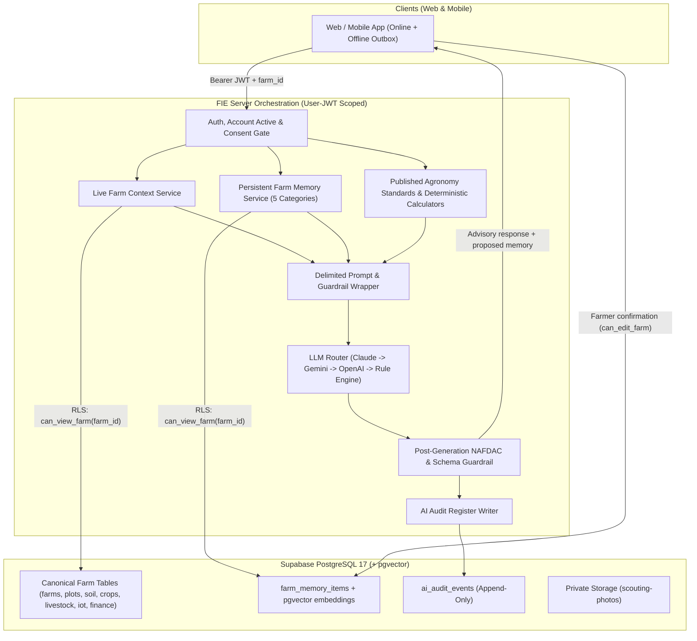
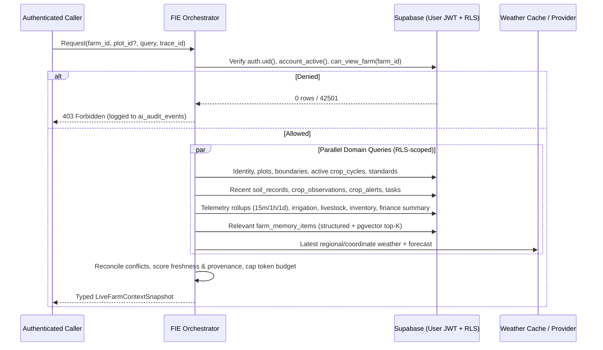
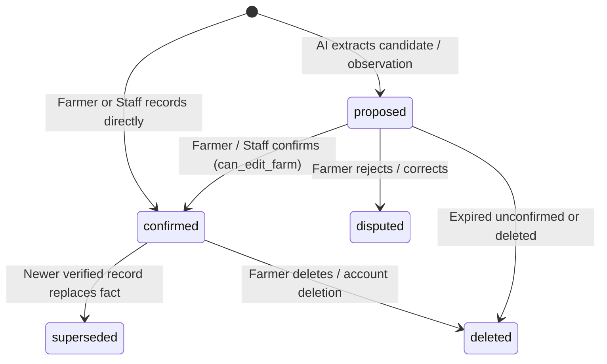
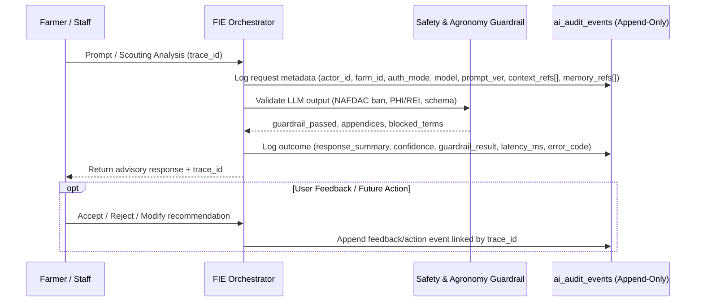

# Batch 03.0 — Target Architecture: Farm Intelligence Engine (FIE)

**Date:** 2026-11-19  
**Status:** Proposed Architecture (Discovery & Design Only — No Implementation in Batch 03.0)

---

## 1. Proposed FIE Architecture

---

## 2. Live Farm Context Retrieval Architecture

### Context Retrieval Flow

### Context Contract, Freshness, Conflict Reconciliation & Ranking
- **Typed `LiveFarmContextSnapshot`** separates every fact into four provenance buckets:
  1. `current_observations`: active `crop_cycles`, open `crop_alerts`/`device_alerts`, latest `telemetry_rollups`, recent `crop_observations` (last 30d).
  2. `historical_records`: prior `crop_harvests`, completed `crop_cycle_operations`, `soil_records`, `farm_financial_transactions` summaries, `farm_livestock_production_logs`.
  3. `external_sources`: `weather_cache` / NiMet / Open-Meteo forecasts, published `farm_agronomic_standards`.
  4. `ai_derived`: `farm_memory_items` (`status = 'proposed' | 'confirmed'`) and prior `crop_observations.ai_diagnosis` (explicitly tagged non-authoritative unless confirmed).
- **Conflict Reconciliation Rules (Deterministic):**
  - **Soil pH / nutrients:** `soil_records` (`agent_verified`/`platform_verified` > `self_reported` by latest `tested_on`) overrides `plots.soil_*` and `farms.soil_information`.
  - **Soil moisture:** `telemetry_rollups` (`quality_flag = 'valid'`, `< 6h` old) overrides `irrigation_zones.current_moisture_pct`.
  - **Active crop:** `crop_cycles` (`status = 'active'`) overrides `plots.current_crop`.
  - **Machinery hours:** `machinery_telemetry.engine_hours` (if active) or sum of `farm_machinery_usage_logs` overrides stale `farm_machinery_assets.engine_hours`.
- **Stale / Missing Data Handling:** Every section carries `asOf`, `stalenessHours`, and `missingReasons[]`. If telemetry `> 12h` old or `soil_records` `> 365d` old, the snapshot marks `stale: true` so the prompt instructs the LLM to state uncertainty rather than guess.
- **Relevance Ranking:** Rank by `(1) active alert / unresolved problem -> (2) target plot_id & active crop_cycle -> (3) recency decay -> (4) verification confidence -> (5) semantic similarity`.

---

## 3. Persistent Farm Memory Architecture

### Five Memory Categories
| Category | Scope | Examples | Default TTL / Review |
|---|---|---|---|
| **Episodic** | `farm_id` (+ optional `plot_id`, `crop_cycle_id`) | Pest outbreak on Plot A, flood event, treatment outcome, harvest shortfall | Season-bound (`180d` review) |
| **Semantic** | `farm_id` (+ optional `plot_id`) | Confirmed clay-loam drainage issue, recurring striga pressure, perennial crop spacing | `365d` review |
| **Procedural** | `farm_id` | Approved spray schedule timing, irrigation threshold preference, harvest grading workflow | `365d` review |
| **Preference** | `profile_id` (+ `farm_id`) | Preferred language (`en`/`yo`/`pcm`), units (ha vs acres), concise vs detailed tone | User-editable; no auto-expiry |
| **Unresolved** | `farm_id` (+ `crop_cycle_id`) | Open `crop_alerts`, pending follow-up scouting, unconfirmed AI recommendation | `14d`–`30d` review until resolved |

### Memory Record Schema & Provenance
Every `farm_memory_items` row MUST store:
- `id`, `farm_id` (NOT NULL FK `farms`), `plot_id` (nullable FK), `crop_cycle_id` (nullable FK), `profile_id` (nullable FK).
- `category` (`episodic|semantic|procedural|preference|unresolved`), `title`, `content`, `embedding vector(1536)` (nullable, hybrid retrieval).
- `source_kind` (`farmer_reported|staff_verified|sensor|external_weather|ai_inferred`), `source_table`, `source_record_id`.
- `verification_status` (`proposed|confirmed|disputed|superseded|deleted`), `confidence` (`0.00`–`1.00`).
- `created_at`, `updated_at`, `review_after`, `expires_at`, `confirmed_by`, `confirmed_at`.
- **Rule:** AI-inferred memories ALWAYS start as `verification_status = 'proposed'` and `source_kind = 'ai_inferred'`. They NEVER overwrite `'confirmed'` farmer/staff facts.

### Memory Lifecycle

### Storage Technology Decision
**Hybrid PostgreSQL 17 + `pgvector`** inside existing Supabase: relational indexes on `(farm_id, category, verification_status, review_after)` handle 90% of structured deterministic lookups, while `pgvector` HNSW indexes on `farm_memory_items.embedding` and published `farm_agronomic_standards` handle semantic cross-season recall without adding external vector DB cost or cross-tenant sync risk.

---

## 4. AI Audit Register (`ai_audit_events`) Architecture

### AI Audit Event Lifecycle

- **Key Fields:** `id`, `trace_id` (uuid), `parent_event_id` (self-FK), `farm_id`, `actor_id`, `auth_role`, `interaction_kind` (`chat|vision_scouting|proactive_alert|action_proposal`), `provider`, `model_id`, `prompt_version`, `context_record_refs` (jsonb), `memory_ids_used` (uuid[]), `external_sources` (jsonb), `tools_invoked` (jsonb), `recommendation_summary` (text), `confidence`, `guardrail_passed`, `guardrail_details` (jsonb), `human_outcome` (`accepted|rejected|modified|pending`), `execution_status`, `error_code`, `created_at`.
- **Tamper Resistance & Privacy:** Protected by `private.forbid_change()` (`BEFORE UPDATE OR DELETE`). Never stores bearer tokens, API keys, raw `imageBase64`, or unredacted phone/bank PII.
