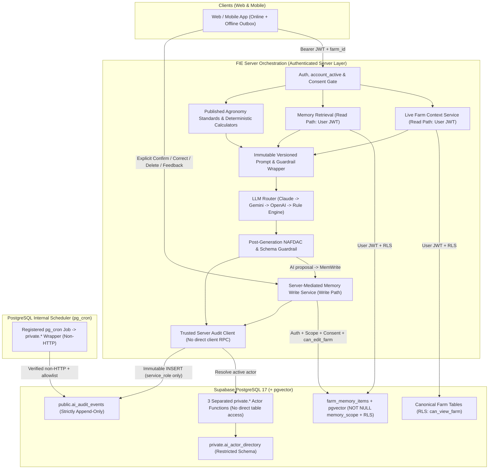
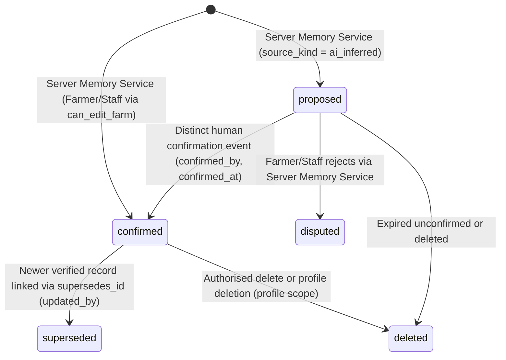

# Batch 03.0 — Target Architecture: Farm Intelligence Engine (FIE)

**Date:** 2026-11-19  
**Status:** Proposed Architecture — Final Batch 03.0 Review Corrections Applied (Discovery & Design Only)

---

## 1. Proposed FIE Architecture (Read vs. Write & Audit Boundaries)

All client interactions pass through authenticated server-side API routes or Server Actions. **Clients never write directly to `farm_memory_items`, `private.ai_actor_directory`, or `public.ai_audit_events`.**



---

## 2. Live Farm Context Retrieval Architecture

### Context Retrieval Flow


### Context States & Domain-Specific Provenance
Every retrieved fact in `LiveFarmContextSnapshot` is classified into one of **seven explicit states**:
`verified_current` | `unverified_provisional` | `stale` | `missing` | `conflicting` | `awaiting_sync` | `invalid_rejected`

**Non-negotiable rules:**
1. **Missing data is NEVER treated as zero** (e.g., missing soil P/K, missing `tested_on`, or missing rain must be marked `missing`, never `0` or current).
2. **AI inferences NEVER silently overwrite verified records.**
3. **When two credible sources disagree**, FIE marks the field `conflicting`, surfaces both values with timestamps/provenance, and asks the farmer/agronomist for clarification rather than manufacturing certainty.

| Domain | Precedence & Conflict Rules | Freshness / Quality / Validation |
|---|---|---|
| **1. Soil chemistry & nutrients** | `soil_records` (`agent_verified`/`platform_verified`) > `soil_records` (`self_reported`) > `plots.soil_*` > `farms.soil_information`. **IoT sensors never override verified lab NPK/pH.** | `soil_test_age_days = current_date - tested_on`. Stale when `soil_test_age_days > approved_validity_days` (`365` provisional, `[Requires Agronomy Validation]`, configurable per domain/crop). `tested_on > current_date` → `invalid_rejected`; `tested_on IS NULL` → `missing`. Stale tests remain historical only, never `verified_current`. |
| **2. Soil moisture & irrigation** | `telemetry_rollups` (`quality_flag = 'valid'`, `< 6h`) > recent `irrigation_events` (`< 24h`) > manual `irrigation_zones.current_moisture_pct`. | Exclude `'faulty'`/`'quarantined'` readings; weight `'suspicious'` lower; stale if `> 12h`. |
| **3. Crop identity, variety & stage** | Active `crop_cycles` (`status = 'active'`) > `plots.current_crop`. | Phenology updates from `crop_observations` remain `unverified_provisional` until confirmed. |
| **4. Weather & environment** | On-farm calibrated weather sensor (`quality_flag = 'valid'`) > `weather_cache` (NiMet/Open-Meteo) > regional pilot capital fallback. | Stale if `> 3h` (current) or `> 12h` (forecast). |
| **5. Farm inventory & stock** | Ledger sum of `farm_inventory_transactions` > `farm_inventory.quantity` cache. Pending mobile `outbox` items tagged `awaiting_sync`. | Flag divergence between ledger sum and cached quantity as `conflicting`. |
| **6. Financial & marketplace** | `marketplace_journal_entries` / `marketplace_orders` > `farm_financial_transactions`. Never AI-inferred. | Append-only ledger authoritative; offline cash entries tagged `unverified_provisional`. |
| **7. Equipment & IoT telemetry** | **Plot IoT:** `public.telemetry_readings` / `telemetry_rollups` (`quality_flag = 'valid'`). **Machinery:** Existing `public.machinery_telemetry` (`20261011100000:62-77`, linked via `machinery_id` & `farm_id`) > `farm_machinery_usage_logs` > `farm_machinery_assets.engine_hours`. | `machinery_telemetry` currently lacks a `quality_flag` column and same-farm `machinery_id` trigger; non-monotonic/implausible `engine_hours` or disagreements with `farm_machinery_usage_logs` are marked `conflicting` or `unverified_provisional`. |
| **8. Farmer observations & scouting** | `crop_observations` reviewed by agronomist/staff > farmer-reported observation > `crop_observations.ai_diagnosis`. | `ai_diagnosis` stays `unverified_provisional` until human confirmation. |

---

## 3. Persistent Farm Memory Architecture

### Non-Null Memory Scope & Ownership vs. Attribution Separation
A single `public.farm_memory_items` table separates **ownership** (`farm_id` vs. `profile_id`) from **creation/confirmation attribution** (`created_by`, `confirmed_by`, `updated_by`), governed by a **`NOT NULL` `memory_scope` discriminator** (`'farm' | 'profile'`):

- **Database row-consistency `CHECK` constraints** (never a substitute for RLS/authorisation):
  - `memory_scope text NOT NULL CHECK (memory_scope IN ('farm', 'profile'))`
  - `(memory_scope = 'farm' AND farm_id IS NOT NULL AND profile_id IS NULL AND category IN ('episodic', 'semantic', 'procedural', 'preference', 'unresolved')) OR (memory_scope = 'profile' AND farm_id IS NULL AND profile_id IS NOT NULL AND category = 'preference')`

| Aspect | `memory_scope = 'farm'` | `memory_scope = 'profile'` |
|---|---|---|
| **Owner** | `farm_id` (`NOT NULL` FK `farms`); `profile_id` MUST be `NULL` | `profile_id` (`NOT NULL` FK `profiles`); `farm_id` MUST be `NULL` |
| **Allowed Categories** | `episodic`, `semantic`, `procedural`, `preference`, `unresolved` | `preference` **only** (language, units, communication tone) |
| **Creation / Edit Attribution** | `created_by`, `confirmed_by`, `updated_by` (nullable FKs `profiles`, `ON DELETE SET NULL`), `source_kind` | `created_by` (`= profile_id` on user-created), `updated_by`, `source_kind` |
| **Read RLS** | `private.can_view_farm(farm_id)` | `profile_id = auth.uid()` **only** (never visible across farms/orgs) |
| **Write Boundary** | Server Memory Write Service (`can_edit_farm(farm_id)` for confirmation) | Server Memory Write Service (`profile_id = auth.uid()` only) |
| **Account Deletion** | Surviving org farms **preserve** farm knowledge (`farm_id` intact); deleted user's attribution columns set to `NULL` | **Hard-deleted / anonymised** when owning `profile_id` is deleted |

### Server-Mediated Memory Write & Lifecycle


### Storage & `pgvector` Cost / Capacity Model
PostgreSQL 17 + `pgvector` is selected because it is available in Supabase and enforces row-level tenant isolation natively. However, **it is not zero-cost** (storage, embeddings, HNSW index maintenance, compute, WAL/backups, Supabase Free `500 MB` → Pro limits, and LLM inference).
- **Provisional Engineering Target:** `< 50 ms` p95 vector-retrieval latency is a **provisional engineering target** (not a proven benchmark), to be measured separately from embedding generation and LLM inference under realistic Staging workloads (representative volumes, dimensions, HNSW config, RLS filtering, and concurrency) and revised based on measured results (`ADR-003`). Every vector row stores `embedding_model` and `embedding_version`.

---

## 4. AI Audit Register (`public.ai_audit_events` & `private.ai_actor_directory`)

### Protected Identity Directory & Immutable Audit Evidence
1. **`private.ai_actor_directory` (`owner: postgres`, restricted `private` schema, RLS enabled, `REVOKE ALL FROM PUBLIC, anon, authenticated`):** Stores `actor_subject_id uuid PK`, `actor_kind` (`'human' | 'system'`), `profile_id uuid UNIQUE REFERENCES public.profiles(id) ON DELETE SET NULL`, `system_principal text UNIQUE`, `created_at`, `deleted_at`. Direct table queries from general application code are prohibited; access occurs only through **3 separated `SECURITY DEFINER` functions** (`SET search_path = ''`, `GRANT EXECUTE TO service_role` only): `private.resolve_or_create_ai_actor(p_profile_id)`, `private.anonymise_ai_actor(p_profile_id)` (account-deletion only; idempotent; cannot reactivate), and `private.lookup_ai_actor_subject(p_actor_subject_id)`.
2. **`public.ai_audit_events` (Strictly Append-Only via `private.forbid_change()`):** Stores `actor_subject_id` (non-PII), `actor_kind`, `system_job_name`, `trace_id`, `parent_event_id`, `farm_id`, `provider`, `model_id`, `prompt_version`, `context_record_refs`, `memory_ids_used`, `guardrail_result`, `human_outcome`, `execution_status`, `error_code`, `created_at`.

### Two-Pathway Audit Ingestion & Verifiable Scheduled-Job Identity
- **No general `authenticated` RPC:** `REVOKE ALL FROM PUBLIC, anon, authenticated` on the general AI audit writer so clients cannot fabricate AI executions, models, or guardrail results.
- **Pathway A (Trusted Server AI Orchestration):** Server validates user via `auth.getUser()`, checks `account_active` and `can_view_farm`/`can_edit_farm`, validates payload schema, resolves `actor_subject_id`, and inserts the verified trace (`service_role`).
- **Pathway B (Human Feedback):** Routed through the trusted server API (or a separate feedback-only RPC restricted to `human_outcome in ('accepted','rejected','modified')` on an existing `trace_id` under `can_view_farm`, never setting model/guardrail/system fields).
- **Scheduled Jobs (`actor_kind = 'system'`):** `pg_cron` jobs registered in `cron.job` + `private.ai_scheduled_jobs` invoke a non-API `private.*` wrapper that verifies `current_setting('request.jwt.claim.role', true)` is NULL/empty (not HTTP), validates against the allowlist, enforces `(job_name, run_window)` idempotency, and never trusts `current_user` or client-supplied `system_job_name`.

```mermaid
sequenceDiagram
  participant User as Authenticated Caller
  participant FIE as Trusted FIE Server Layer
  participant Cron as pg_cron (Non-HTTP)
  participant Writer as Audit Writer (service_role / private)
  participant Dir as private.ai_actor_directory
  participant Audit as public.ai_audit_events (Append-Only)

  User->>FIE: Authenticated Request (JWT)
  FIE->>FIE: Verify auth.getUser(), account_active, can_view_farm
  FIE->>Writer: Insert verified AI trace (actual model, prompt_ver, guardrail)
  Writer->>Dir: private.resolve_or_create_ai_actor(user_id)
  Writer->>Audit: INSERT immutable event (actor_subject_id, trace_id)
  Cron->>Writer: Invoke registered private.* wrapper (no HTTP JWT)
  Writer->>Audit: INSERT idempotent system event (allowlisted system_principal)
  Note over Dir,Audit: On Account Deletion: private.anonymise_ai_actor() sets profile_id=NULL; Audit stays 100% immutable
```
