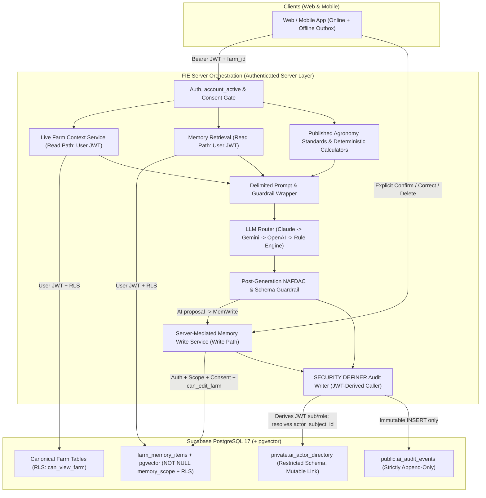
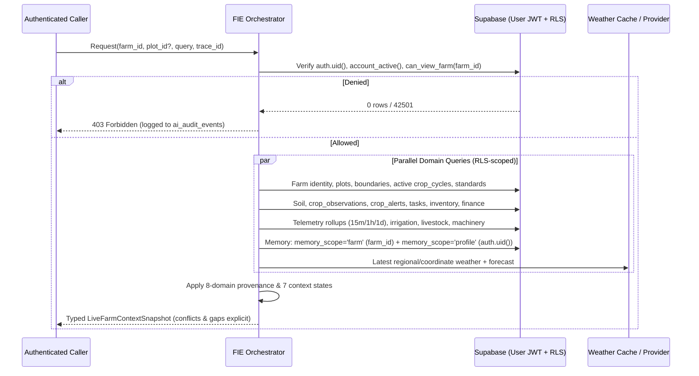
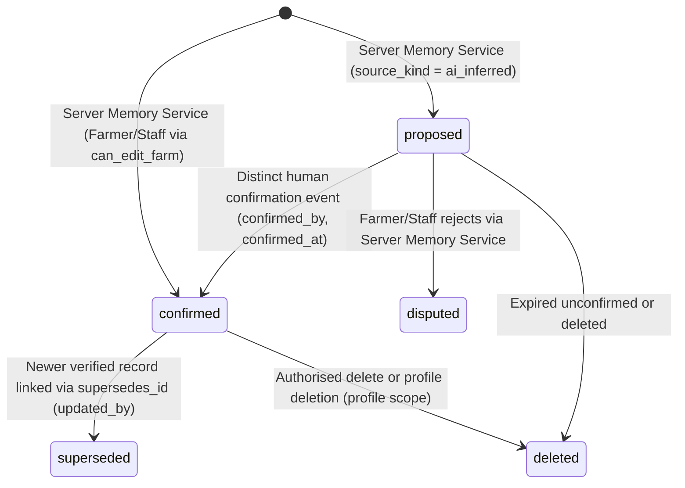

# Batch 03.0 — Target Architecture: Farm Intelligence Engine (FIE)

**Date:** 2026-11-19  
**Status:** Proposed Architecture — Revised for Batch 03.0 Identity & Memory Controls (Discovery & Design Only)

---

## 1. Proposed FIE Architecture (Read vs. Write Boundaries)

All client interactions pass through authenticated server-side API routes or Server Actions. **Clients never write directly to `farm_memory_items`, `private.ai_actor_directory`, or `public.ai_audit_events`.**



---

## 2. Live Farm Context Retrieval Architecture

### Context Retrieval Flow


### Context States & Domain-Specific Provenance
Every retrieved fact in `LiveFarmContextSnapshot` is classified into one of **seven explicit states**:
`verified_current` | `unverified_provisional` | `stale` | `missing` | `conflicting` | `awaiting_sync` | `invalid_rejected`

**Non-negotiable rules:**
1. **Missing data is NEVER treated as zero** (e.g., missing soil P/K or missing rain must be marked `missing`, never `0`).
2. **AI inferences NEVER silently overwrite verified records.**
3. **When two credible sources disagree**, FIE marks the field `conflicting`, surfaces both values with timestamps/provenance, and asks the farmer/agronomist for clarification rather than manufacturing certainty.

| Domain | Precedence & Conflict Rules | Freshness / Quality / Validation |
|---|---|---|
| **1. Soil chemistry & nutrients** | `soil_records` (`agent_verified`/`platform_verified`) > `soil_records` (`self_reported`) > `plots.soil_*` > `farms.soil_information`. **IoT sensors never override verified lab NPK/pH.** | Stale if `tested_on > 365d` *(Requires Agronomy Validation for tropical crop intervals)*. |
| **2. Soil moisture & irrigation** | `telemetry_rollups` (`quality_flag = 'valid'`, `< 6h`) > recent `irrigation_events` (`< 24h`) > manual `irrigation_zones.current_moisture_pct`. | Exclude `'faulty'`/`'quarantined'` readings; weight `'suspicious'` lower; stale if `> 12h`. |
| **3. Crop identity, variety & stage** | Active `crop_cycles` (`status = 'active'`) > `plots.current_crop`. | Phenology updates from `crop_observations` remain `unverified_provisional` until confirmed. |
| **4. Weather & environment** | On-farm calibrated weather sensor (`quality_flag = 'valid'`) > `weather_cache` (NiMet/Open-Meteo) > regional pilot capital fallback. | Stale if `> 3h` (current) or `> 12h` (forecast). |
| **5. Farm inventory & stock** | Ledger sum of `farm_inventory_transactions` > `farm_inventory.quantity` cache. Pending mobile `outbox` items tagged `awaiting_sync`. | Flag divergence between ledger sum and cached quantity as `conflicting`. |
| **6. Financial & marketplace** | `marketplace_journal_entries` / `marketplace_orders` > `farm_financial_transactions`. Never AI-inferred. | Append-only ledger authoritative; offline cash entries tagged `unverified_provisional`. |
| **7. Equipment & IoT telemetry** | `machinery_telemetry` / `telemetry_readings` (`quality_flag = 'valid'`) > `farm_machinery_usage_logs` > `farm_machinery_assets.engine_hours`. | Respect `calibrated_at` / `next_calibration_due`; uncalibrated sensors flagged `unverified_provisional`. |
| **8. Farmer observations & scouting** | `crop_observations` reviewed by agronomist/staff > farmer-reported observation > `crop_observations.ai_diagnosis`. | `ai_diagnosis` stays `unverified_provisional` until human confirmation. |

---

## 3. Persistent Farm Memory Architecture

### Non-Null Memory Scope & Ownership vs. Attribution Separation
A single `public.farm_memory_items` table separates **ownership** (`farm_id` vs. `profile_id`) from **creation/confirmation attribution** (`created_by`, `confirmed_by`, `updated_by`), governed by a **`NOT NULL` `memory_scope` discriminator** (`'farm' | 'profile'`):

- **Database row-consistency `CHECK` constraints** (never a substitute for RLS/authorisation):
  - `memory_scope text NOT NULL CHECK (memory_scope IN ('farm', 'profile'))`
  - `(memory_scope = 'farm' AND farm_id IS NOT NULL AND profile_id IS NULL AND category IN ('episodic', 'semantic', 'procedural', 'preference', 'unresolved')) OR (memory_scope = 'profile' AND farm_id IS NULL AND profile_id IS NOT NULL AND category = 'preference')`

| Aspect | `memory_scope = 'farm'` | `memory_scope = 'profile'` |
|---|---|---|
| **Owner** | `farm_id` (`NOT NULL` FK `farms`); `profile_id` MUST be `NULL` | `profile_id` (`NOT NULL` FK `profiles`); `farm_id` MUST be `NULL` |
| **Allowed Categories** | `episodic`, `semantic`, `procedural`, `preference`, `unresolved` | `preference` **only** (language, units, communication tone) |
| **Creation Attribution** | `created_by` (nullable FK `profiles`, `ON DELETE SET NULL`), `source_kind` | `created_by` (`= profile_id` on user-created), `source_kind` |
| **Confirmation / Edit Attribution** | `confirmed_by`, `confirmed_at`, `updated_by`, `updated_at` | `updated_by`, `updated_at` |
| **Read RLS** | `private.can_view_farm(farm_id)` | `profile_id = auth.uid()` **only** (never visible across farms/orgs) |
| **Write Boundary** | Server Memory Write Service (`can_edit_farm(farm_id)` for confirmation) | Server Memory Write Service (`profile_id = auth.uid()` only) |
| **Membership Loss** | Access revoked immediately when `can_view_farm(farm_id)` becomes false | Unaffected (user retains personal preferences across farms) |
| **Account Deletion** | Surviving org farms **preserve** farm knowledge (`farm_id` intact); `created_by`/`confirmed_by`/`updated_by` for deleted user set to `NULL` | **Hard-deleted / anonymised** when owning `profile_id` is deleted |

### Server-Mediated Memory Write & Lifecycle

- **No direct client writes:** Both AI proposals and farmer confirmations/corrections/deletions go through the authenticated server-side Memory Write Service, which validates `auth.uid()`, `account_active`, `'ai_intelligence'` consent in `public.consents`, non-null `memory_scope` rules, and `can_edit_farm(farm_id)` (for `'farm'` confirmations).

### Storage & `pgvector` Cost / Capacity Model
PostgreSQL 17 + `pgvector` is selected because it is available in Supabase and enforces row-level tenant isolation natively. However, **it is not zero-cost**:
- **Cost components:** Database storage (rows + `vector` columns), embedding-generation API calls, HNSW index memory/maintenance overhead, query compute, backup/WAL growth, Supabase Free (`500 MB` DB) → Pro plan thresholds, and separate LLM inference costs.
- **Provisional Engineering Target & Batch 03.1 Measurement Gate:** A `< 50 ms` p95 vector-retrieval latency is a **provisional engineering target** (not a proven benchmark). Before production rollout, retrieval latency must be measured separately from embedding generation and LLM inference under realistic Staging workloads (representative memory volumes, dimensions, index config, RLS filtering, and concurrency), and revised if needed. Every vector row stores `embedding_model` and `embedding_version` for safe re-embedding migrations.

---

## 4. AI Audit Register (`ai_audit_events` & `private.ai_actor_directory`)

### Separating Protected Mutable Identity from Immutable Audit Evidence
To preserve **strict append-only immutability** (`private.forbid_change()` blocking all `UPDATE` and `DELETE` on `public.ai_audit_events`) while complying with Batch 02.5 account deletion:
1. **`private.ai_actor_directory` (Restricted Schema, Mutable Identity Link):** Resides in the `private` schema (inaccessible to PostgREST/Data API; `REVOKE ALL FROM PUBLIC, anon, authenticated`). Stores minimum fields only: `actor_subject_id uuid PRIMARY KEY`, `actor_kind text NOT NULL CHECK (actor_kind IN ('human', 'system'))`, `profile_id uuid UNIQUE REFERENCES public.profiles(id) ON DELETE SET NULL`, `system_principal text UNIQUE`, `created_at timestamptz NOT NULL`, `deleted_at timestamptz`. During `execute_account_deletion`, only `private.ai_actor_directory` sets `profile_id = NULL, deleted_at = COALESCE(deleted_at, now())` (idempotent; deleted mappings cannot be reactivated).
2. **`public.ai_audit_events` (Strictly Append-Only):** Stores `actor_subject_id uuid NOT NULL` (never PII, never updated or deleted), `actor_kind` (`'human' | 'system'`), `trace_id`, `parent_event_id`, `farm_id`, `provider`, `model_id`, `prompt_version`, `context_record_refs`, `memory_ids_used`, `guardrail_result`, `human_outcome`, `execution_status`, `error_code`, `created_at`.

### Caller-Bound `SECURITY DEFINER` Audit Writer Contract
- Because `SECURITY DEFINER` functions run as their owner (`postgres`), **`current_user` is NEVER treated as proof of the original requester's identity or role.**
- The audit writer inspects verified Supabase JWT claims (`auth.role()`, `auth.uid()`):
  - **Human events (`actor_kind = 'human'`):** Requires `auth.role() = 'authenticated'` and non-null `auth.uid()`, checks `private.account_active(auth.uid())`, and if `farm_id IS NOT NULL`, verifies `private.can_view_farm(farm_id)` (and `can_edit_farm` for edit/confirmation traces). Rejects client-supplied `actor_id`/`profile_id` and rejects `actor_kind = 'system'`.
  - **System events (`actor_kind = 'system'`):** Permitted **only** when `auth.role() = 'service_role'` (or internal `postgres` scheduled job) with an allowlisted `system_job_name` / `system_principal`.
- **Privileges:** `SET search_path = ''`, `REVOKE ALL FROM PUBLIC, anon`, `GRANT EXECUTE TO authenticated, service_role`, `INSERT`-only. Failures surface critically rather than being silently dropped.

```mermaid
sequenceDiagram
  participant User as Authenticated Caller
  participant FIE as FIE Server Layer
  participant Writer as SECURITY DEFINER Audit Writer
  participant Dir as private.ai_actor_directory
  participant Audit as public.ai_audit_events (Append-Only)

  User->>FIE: Authenticated Request (JWT)
  FIE->>Writer: Write Trace (no client actor_id trusted)
  Writer->>Writer: Validate JWT claims (auth.role/auth.uid), reject current_user trust
  Writer->>Dir: Resolve/create actor_subject_id (active mapping only)
  Writer->>Audit: INSERT immutable event (actor_subject_id, trace_id, model, guardrail)
  Note over Dir,Audit: On Account Deletion: Dir sets profile_id=NULL & deleted_at; Audit stays 100% immutable
```
