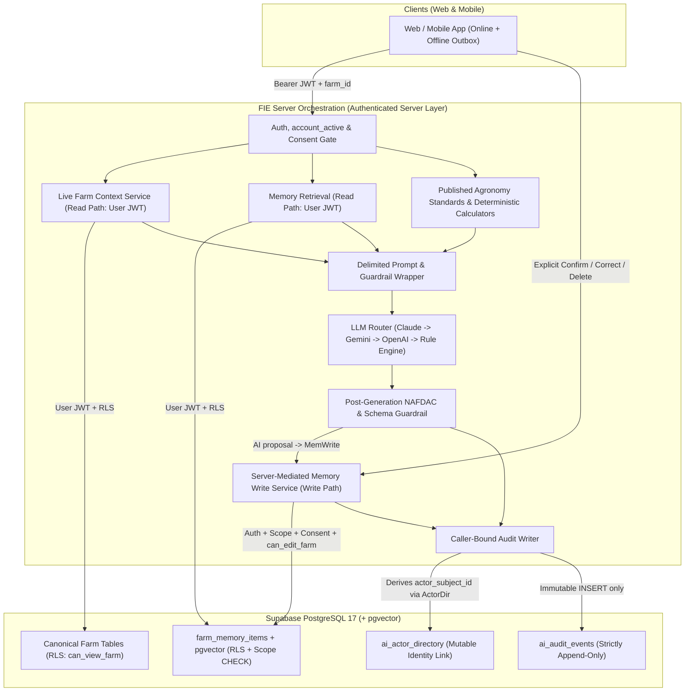
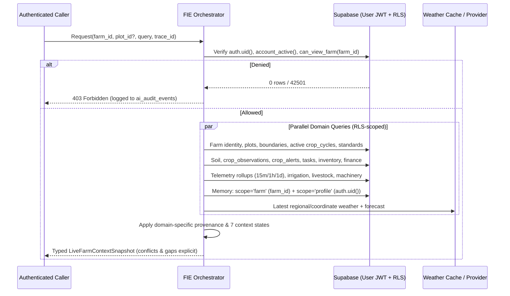
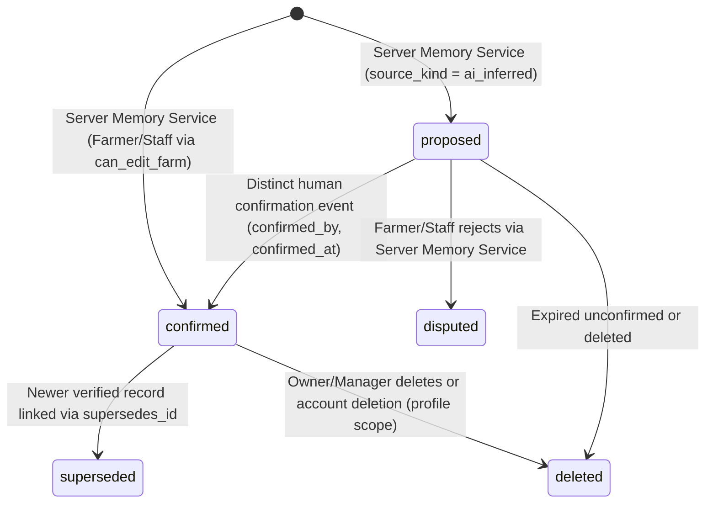

# Batch 03.0 — Target Architecture: Farm Intelligence Engine (FIE)

**Date:** 2026-11-19  
**Status:** Proposed Architecture — Revised for Batch 03.0 Review Findings 1–6 (Discovery & Design Only)

---

## 1. Proposed FIE Architecture (Read vs. Write Boundaries)

All client interactions pass through authenticated server-side API routes or Server Actions. **Clients never write directly to `farm_memory_items` or `ai_audit_events`.**



---

## 2. Live Farm Context Retrieval Architecture

### Context Retrieval Flow


### Context States & Domain-Specific Provenance (Correction 4)
Every retrieved fact in `LiveFarmContextSnapshot` is classified into one of **seven explicit states**:
`verified_current` | `unverified_provisional` | `stale` | `missing` | `conflicting` | `awaiting_sync` | `invalid_rejected`

**Non-negotiable rules:**
1. **Missing data is NEVER treated as zero** (e.g., missing soil P/K or missing rain must be marked `missing`, never `0`).
2. **AI inferences NEVER silently overwrite verified records.**
3. **When two credible sources disagree**, FIE marks the field `conflicting`, surfaces both values with timestamps/provenance, and asks the farmer/agronomist for clarification rather than manufacturing certainty.

| Domain | Precedence & Conflict Rules | Freshness / Quality / Validation |
|---|---|---|
| **1. Soil chemistry & nutrients** | `soil_records` (`agent_verified`/`platform_verified`) > `soil_records` (`self_reported`) > `plots.soil_*` > `farms.soil_information`. **IoT sensors never override verified lab NPK/pH.** | Stale if `tested_on > 365d` *(Requires Agronomy Validation for tropical crop intervals)*. |
| **2. Soil moisture & irrigation** | `telemetry_rollups` (`quality_flag = 'valid'`, `< 6h`) > recent `irrigation_events` (`< 24h`) > manual `irrigation_zones.current_moisture_pct`. | Exclude `'faulty'`/`'quarantined'` readings; weight `'suspicious'` lower; stale if `> 12h`. |
| **3. Crop identity, variety & stage** | Active `crop_cycles` (`status = 'active'`) > `plots.current_crop`. | Phenology updates from `crop_observations` remain `unverified_provisional` until confirmed. |
| **4. Weather & environment** | On-farm calibrated weather sensor (`quality_flag = 'valid'`) > `weather_cache` (NiMet/Open-Meteo) > regional pilot capital fallback. | Stale if `> 3h` (current) or `> 12h` (forecast). |
| **5. Farm inventory & stock** | Ledger sum of `farm_inventory_transactions` > `farm_inventory.quantity` cache. Pending mobile `outbox` items tagged `awaiting_sync`. | Flag divergence between ledger sum and cached quantity as `conflicting`. |
| **6. Financial & marketplace** | `marketplace_journal_entries` / `marketplace_orders` > `farm_financial_transactions`. Never AI-inferred. | Append-only ledger authoritative; offline cash entries tagged `unverified_provisional`. |
| **7. Equipment & IoT telemetry** | `machinery_telemetry` / `telemetry_readings` (`quality_flag = 'valid'`) > `farm_machinery_usage_logs` > `farm_machinery_assets.engine_hours`. | Respect `calibrated_at` / `next_calibration_due`; uncalibrated sensors flagged `unverified_provisional`. |
| **8. Farmer observations & scouting** | `crop_observations` reviewed by agronomist/staff > farmer-reported observation > `crop_observations.ai_diagnosis`. | `ai_diagnosis` stays `unverified_provisional` until human confirmation. |

---

## 3. Persistent Farm Memory Architecture (Corrections 1, 5 & 6)

### Explicit Memory Scope Model (`memory_scope`)
A single `public.farm_memory_items` table uses an explicit `memory_scope` discriminator (`'farm' | 'profile'`) enforced by database `CHECK` constraints and RLS:

| Scope | `farm_id` | `profile_id` | Allowed Categories | Read RLS | Write Path | On Membership Loss / Account Deletion |
|---|---|---|---|---|---|---|
| **`'farm'`** | **NOT NULL** (FK `farms`) | Nullable (`created_by`) | `episodic`, `semantic`, `procedural`, `preference`, `unresolved` | `private.can_view_farm(farm_id)` | Server Memory Write Service + `can_edit_farm(farm_id)` for confirmation | Access revoked immediately on org removal; on account deletion, surviving org farms retain `farm_id` with `created_by`/`confirmed_by` nulled. |
| **`'profile'`** | **NULL** | **NOT NULL** (`= auth.uid()`) | `preference` **only** (language, units, tone) | `profile_id = auth.uid()` **only** | Server Memory Write Service (`profile_id = auth.uid()`) | Isolated per user across all farms; never readable by other farm/org members; hard-deleted on account deletion. |

**Enforced `CHECK` constraint:**
`(memory_scope = 'farm' AND farm_id IS NOT NULL) OR (memory_scope = 'profile' AND farm_id IS NULL AND profile_id IS NOT NULL AND category = 'preference')`

### Server-Mediated Memory Write & Lifecycle

- **No direct client writes:** Both AI proposals and farmer confirmations/corrections/deletions go through the authenticated server-side Memory Write Service, which validates `auth.uid()`, `account_active`, `'ai_intelligence'` consent in `public.consents`, scope constraints, and `can_edit_farm(farm_id)` (for `'farm'` confirmations).

### Storage & `pgvector` Cost / Capacity Model (Correction 5)
PostgreSQL 17 + `pgvector` is selected because it is available in Supabase and enforces row-level tenant isolation natively. However, **it is not zero-cost**:
- **Cost components:** Database storage (rows + `vector` columns), embedding-generation API calls, HNSW index memory/maintenance overhead, query compute, backup/WAL growth, Supabase Free (`500 MB` DB) → Pro plan thresholds, and separate LLM inference costs.
- **Batch 03.1 Measurement Gate (before production rollout):** Measure expected memory-item count per active farm, embedding dimensions (e.g., `512` vs `1536`), generation cadence, query p95 latency (`< 50 ms` target), storage growth rate, and store `embedding_model` + `embedding_version` on every embedded row to support safe re-embedding migrations.

---

## 4. AI Audit Register (`ai_audit_events` & `ai_actor_directory`) (Corrections 2 & 3)

### Separating Mutable Identity from Immutable Audit Evidence
To preserve **strict append-only immutability** (`private.forbid_change()` blocking all `UPDATE` and `DELETE` on `ai_audit_events`) while complying with Batch 02.5 account deletion:
1. **`public.ai_actor_directory` (Mutable identity link):** Maps `actor_subject_id uuid PRIMARY KEY` ↔ `profile_id uuid UNIQUE REFERENCES public.profiles(id) ON DELETE SET NULL`, `deleted_at timestamptz`. During `execute_account_deletion`, only `ai_actor_directory` sets `profile_id = NULL, deleted_at = now()`.
2. **`public.ai_audit_events` (Strictly Append-Only):** Stores `actor_subject_id uuid` (never PII, never updated or deleted), `actor_kind` (`'human' | 'system'`), `trace_id`, `parent_event_id`, `farm_id`, `provider`, `model_id`, `prompt_version`, `context_record_refs`, `memory_ids_used`, `guardrail_result`, `human_outcome`, `execution_status`, `error_code`, `created_at`.

### Caller-Bound Audit Writer Contract
- **Interactive (`actor_kind = 'human'`):** `PUBLIC` and `anon` revoked; `authenticated` caller identity is derived strictly from `auth.uid()` (never a client-supplied `actor_id`), checked via `private.account_active(auth.uid())` and `private.can_view_farm(farm_id)` (when `farm_id IS NOT NULL`).
- **System (`actor_kind = 'system'`):** Permitted **only** for `service_role` / internal `postgres` scheduled jobs with a fixed system principal and `system_job_name`. `authenticated` users cannot insert `actor_kind = 'system'` rows.
- **Audit Failure:** Audit insert errors are logged as critical telemetry and fail closed for any state-changing or actionable workflow.

```mermaid
sequenceDiagram
  participant User as Authenticated Caller
  participant FIE as FIE Server Layer
  participant Writer as Caller-Bound Audit Writer
  participant Dir as ai_actor_directory (Mutable)
  participant Audit as ai_audit_events (Append-Only)

  User->>FIE: Authenticated Request (JWT)
  FIE->>Writer: Write Trace (no client actor_id trusted)
  Writer->>Writer: Derive auth.uid(), verify account_active & can_view_farm
  Writer->>Dir: Resolve/create actor_subject_id for auth.uid()
  Writer->>Audit: INSERT immutable event (actor_subject_id, trace_id, model, guardrail)
  Note over Dir,Audit: On Account Deletion: Dir sets profile_id=NULL; Audit remains 100% immutable
```
