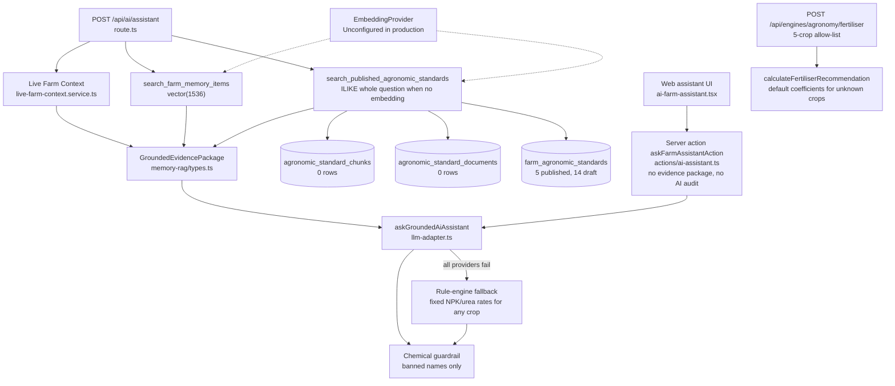
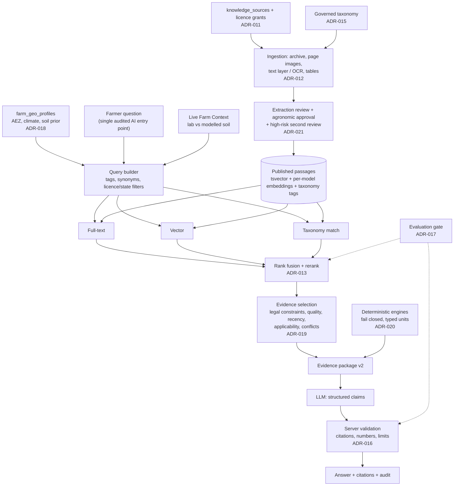

# Batch 04.0 — Current and Target Architecture

**Status:** Proposed | **Date:** 2026-11-22

## Current state (`main` @ `ddad3b0`, Production checked 2026-11-22)

## Target state (end of Batch 04.5)

The 02 fertiliser finding (rule-engine numbers, server-action bypass) is removed in the target: there is one AI
entry point, no default coefficients, and no number reaches a farmer without an engine result or a cited passage.
