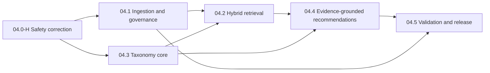

# Batch 04.0 — Implementation Roadmap

**Status:** Revision 3 | **Date:** 2026-11-22

## Mandatory prerequisite: 04.0-H fertiliser safety correction

Batch 04.1 does not start until 04.0-H is merged and verified (D-P6, ADR-020). 04.0-H must block:

1. fertiliser rates for unsupported crops;
2. unapproved or default coefficients;
3. requests with no resolved crop identification;
4. unverified soil inputs (not lab-confirmed, or missing method, depth, date, units or nutrient basis);
5. any numerical recommendation that is not traceable to an approved engine result or a cited passage.

Scope and tests: `02_FERTILISER_SAFETY_FINDING.md`. It is not implemented in PR #25.

## Dependencies

| Phase | Starts when | Blocks | Also needs | Gate |
|---|---|---|---|---|
| 04.0-H Safety correction | Now | 04.1, 04.3 | — | Tests in `02_FERTILISER_SAFETY_FINDING.md` pass in CI |
| 04.1 Ingestion and governance | 04.0-H merged | 04.2, 04.5 | D-P3 prerequisite (CAC verification), D-P4, D-P7, D-L1, D-T2 | First licensed documents published with full audit records; no ingest without a cleared source |
| 04.3 Taxonomy core (parallel with 04.1) | 04.0-H merged | 04.2, 04.4 | D-A1, D-A7 | Every published passage and farm tagged |
| 04.2 Hybrid retrieval | 04.1 gate and 04.3 gate | 04.4 | D-T1, D-T3, D-T4, D-T5, D-P1, D-L7 | Beats the 03.2 baseline on every stratum; RPC security tests (ADR-013) pass |
| 04.4 Evidence-grounded recommendations | 04.2 gate and 04.3 gate | 04.5 | D-A2, D-A3, D-A5, D-A6 | No uncited number reaches a farmer in the test set |
| 04.5 Validation and release | 04.4 gate | Production release | D-L3, all open high-risk items | Staging sign-off by the owner and a qualified reviewer; then Production |

Licensed full-text content depends on provider permissions (D-E1 to D-E6). Until granted, 04.1 can only register
those sources as metadata-only and work with openly licensed material.
