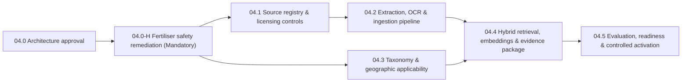

# Batch 04.0 — Implementation Roadmap & Execution Gates

**Status:** Proposed — revision 4 | **Date:** 2026-11-22  
**Scope note:** PR #25 is architecture and documentation only. No Batch 04.0-H or Batch 04.1–04.5 code, migrations,
hosted DB changes, provider activations, or document ingestions have been executed.

## 1. Stage Distinction (Mandatory Governance Separation)

Every implementation batch (`04.0-H` through `04.5`) must pass four distinct, non-overlapping stages:

1. **Architecture approval:** Relevant ADRs and owner/legal/agronomic prerequisite decisions are signed off.
2. **Implementation completion:** Code, forward-only migrations, pgTAP tests, and unit/integration tests are merged on
   an isolated PR with green CI.
3. **Staging verification:** Migrations and benchmarks are applied and verified on `CultivaNode-Staging`
   (`xdbqndgwisshhjqqksbe`) under a separate authorised operation.
4. **Production promotion:** Promoted to `CultivaNode-Production` (`vqbtnftnxyfaembwgfrk`) only after Staging exit
   criteria and sign-offs are recorded.

No downstream batch may bypass its prerequisite controls.

## 2. Dependency Order

## 3. Phase-by-Phase Execution Plan & ADR Mapping

### Batch 04.0 — Final Architecture and ADR Approval
- **Objective:** Obtain independent review and sign-off on ADR-011 through ADR-021 and the Batch 04 architecture.
- **Prerequisites:** Batch 03.3 merged and promoted to Staging and Production.
- **Implementation scope:** Documentation and ADRs only (PR #25).
- **Testing requirements:** Cross-document consistency audit and repository CI checks.
- **Security gates:** Independent review confirming zero unresolved Critical/High architectural contradictions.
- **Deliverables:** Approved Batch 04.0 documentation suite (`01`–`14`, `BATCH_04_0_ASSESSMENT.md`, `ADR-011`–`ADR-021`).
- **Exit criteria:** Ready for independent final review (not declared approved until sign-off); PR #25 merged only after
  explicit approval.

### Batch 04.0-H — Urgent Fertiliser Safety Remediation (**Mandatory Prerequisite Before Batch 04.1**)
- **ADRs covered:** **ADR-020**, **ADR-016** (numeric validator foundation), **ADR-018** (soil provenance/unit checks).
- **Objective:** Close all seven execution paths (`P1`–`P7` in `02_FERTILISER_SAFETY_FINDING.md`) so no unsupported crop
  (e.g. lettuce), unapproved coefficient, missing crop ID, unverified/incomplete soil input, or standalone cited passage
  can produce a farm-specific numerical fertiliser prescription.
- **Prerequisites:** Batch 04.0 approved; D-P6 (confirmed).
- **Implementation scope:** Fail-closed result union in `calculateFertiliserRecommendation`; shared validation schema
  for `EngineClient` and HTTP route; remove numeric templates from `generateAgronomicAdvisorAnswer`; unify AI entry
  points (remove `cropId || "maize"` default in `askFarmAssistantAction`); server-side numeric prescription validator
  enforcing all nine ADR-020 conditions; typed potassium unit conversion (`1 cmol(+)/kg = 391 mg/kg`) with explicit
  oxide/elemental basis; extend `forbid_published_standard_mutation` trigger to all agronomic fields.
- **Testing requirements:** Unit, API route, and pgTAP tests listed in `02_FERTILISER_SAFETY_FINDING.md` (unknown crop,
  missing crop ID, unverified/incomplete soil, standalone cited passage attempting a farm rate, unit conversion,
  post-publication mutation `42501`).
- **Security gates:** Zero unsupported numerical fertiliser prescriptions across `P1`–`P7`; single audited AI entry point.
- **Deliverables:** Code + forward-only migration + passing CI + Staging verification report.
- **Exit criteria:** Merged, Staging-verified, and promoted (or explicitly cleared) before Batch 04.1 starts.

### Batch 04.1 — Knowledge-Source Registry, Licensing Controls and Initial Source Governance
- **ADRs covered:** **ADR-011**, **ADR-019**, **ADR-021**.
- **Objective:** Establish the governed `knowledge_sources` registry, A1–A13 licence grants, metadata-only vs. full-text
  enforcement, five-attribute source authority/conflict model, and independent reviewer governance (no super-admin
  self-approval bypass).
- **Prerequisites:** Batch 04.0-H complete; D-P3 CAC verification prerequisite (before external correspondence/contracts),
  D-P4, D-P5, D-P7, D-L1, D-L2, D-L4, D-A4.
- **Implementation scope:** Source register and licence-grant schema + RLS/triggers; metadata-only hard block on
  all-rights-reserved works without documented permission; reviewer qualification/competence records and independent
  second-review workflow for high-risk rates/doses; recorded time-limited emergency publication path.
- **Testing requirements:** pgTAP tests verifying uploader cannot approve own submission, unlicensed/metadata-only
  sources cannot be ingested or quoted, and high-risk standards require independent second review.
- **Security gates:** No ingestion without cleared licence grant; no silent review bypass (S2, S4, S7).
- **Deliverables:** Forward-only migrations, governance RPCs, pgTAP suite, initial metadata-only source register.
- **Exit criteria:** First appropriately licensed source registered and verified on Staging with full audit trail.

### Batch 04.2 — Document Extraction, OCR, Provenance and Ingestion Pipeline
- **ADRs covered:** **ADR-012** (extending Batch 03.2G/H provenance chain).
- **Objective:** Build sandboxed PDF/text/table/OCR extraction preserving original archived bytes, page images,
  derivative provenance hashes, page-quality scoring, and human review/rejection workflows.
- **Prerequisites:** Batch 04.1 exit criteria met; D-T2, D-L5 (if translations enabled); provider permissions D-E1–D-E6
  for non-open full-text sources (until granted, operates on openly licensed material only).
- **Implementation scope:** Sandboxed no-network extraction worker with page/time/memory limits; table and numeric
  extraction checks; OCR quality thresholds and sampling review queue; derivative `<untrusted_evidence_json>` tagging.
- **Testing requirements:** Malicious/oversized PDF rejection, corrupted-hash fail-closed, OCR low-quality quarantine,
  end-to-end byte-to-passage hash verification tests.
- **Security gates:** Sandboxed parser isolation (S3); instruction-like passage flagging (S1); immutable source archival.
- **Deliverables:** Extraction pipeline, review queue, pgTAP & integration tests, Staging ingestion dry-run.
- **Exit criteria:** First licensed documents extracted, reviewed, and published on Staging with intact byte-to-passage
  provenance.

### Batch 04.3 — Agricultural Taxonomy and Geographic Applicability Foundations
- **ADRs covered:** **ADR-015**, **ADR-018**.
- **Objective:** Replace hard-coded crop/stage lists with governed agricultural taxonomy (`taxonomy_terms`,
  `taxonomy_synonyms`) and layered `farm_geo_profiles` (eight proposed Nigerian AEZs pending validation, climate,
  distinct modelled vs. lab soil provenance).
- **Prerequisites:** Batch 04.0-H complete (may run in parallel with 04.1/04.2); D-A1, D-A2, D-A7, D-L6.
- **Implementation scope:** Versioned taxonomy tables and multilingual synonym expansion (English, Nigerian English,
  Yoruba, Hausa, Igbo, Pidgin); approved AEZ boundary datasets; `farm_geo_profiles` and strict soil evidence class
  separation (`lab_confirmed` vs. `field_kit` vs. `farmer_reported` vs. `modelled_estimate`).
- **Testing requirements:** Taxonomy synonym resolution, AEZ lookup accuracy, pgTAP/unit tests proving modelled soil
  can never be classified as `lab_confirmed`.
- **Security gates:** Governed approval required for taxonomy/AEZ changes; strict tenant isolation on farm profiles.
- **Deliverables:** Taxonomy + geo-profile migrations, seeded validated priority crop taxonomy (including lettuce
  marked without approved numeric standard until one exists), Staging verification.
- **Exit criteria:** Every published passage and test farm tagged with governed taxonomy and validated geographic scope.

### Batch 04.4 — Hybrid Retrieval, Embedding Storage, Reranking and Evidence Package Integration
- **ADRs covered:** **ADR-013**, **ADR-014**, **ADR-016**, **ADR-019**, **ADR-020**.
- **Objective:** Deliver the partitioned multi-dimension embedding store (`embedding_models` + `passage_embeddings`),
  hybrid full-text + vector + taxonomy RPC (`ADR-013` controls C1–C15), reranking, Evidence Package v2, and the
  server-side structured-claim answer validator.
- **Prerequisites:** Batch 04.2 and Batch 04.3 exit criteria met; D-P1, D-P8, D-L3, D-L7, D-A3, D-A5, D-A6, D-T1,
  D-T3, D-T4, D-T5.
- **Implementation scope:** Partitioned embedding store (keeping `farm_memory_items` `vector(1536)` separate unless a
  separate ADR approves change); remove unescaped `ILIKE` fallback; server-side farm-fact resolution; licence/mode
  enforcement inside `SECURITY DEFINER` RPC; conflict detection; structured answer contract validator separating
  deterministic engine prescriptions from contextualised general source quotes.
- **Testing requirements:** ADR-013 C1–C15 security & foreign-farm-ID pgTAP tests; model-switch & rollback tests;
  structured-claim validator tests proving zero uncited/unapproved numeric prescriptions.
- **Security gates:** S5, S6, S10–S19 verified in CI and Staging; zero question text or farm facts in retrieval logs.
- **Deliverables:** Retrieval & embedding migrations, Evidence Package v2, answer validator, Staging benchmark run.
- **Exit criteria:** All security/RLS tests pass and hybrid retrieval is ready for formal Level A evaluation.

### Batch 04.5 — Evaluation, Production Readiness and Controlled Activation
- **ADRs covered:** **ADR-017**, **ADR-010**, and final verification of **ADR-011**–**ADR-021**.
- **Objective:** Execute the Level A absolute evaluation suite across all language, crop, topic, difficulty, and
  no-answer slices; establish the Level B regression baseline; complete legal/agronomic/owner sign-offs; and execute
  controlled Production activation.
- **Prerequisites:** Batch 04.4 exit criteria met; formal approval of Level A thresholds (D-P9, D-A8); all open
  high-risk legal, agronomic, and institutional items closed.
- **Implementation scope:** CI fixture benchmark + Staging licensed-corpus benchmark harness; per-slice evaluation
  reports with bootstrap confidence intervals; Level B regression gate in CI; Production runbook and rollback drill.
- **Testing requirements:** Full Level A pass (including **0** unsupported numerical fertiliser prescriptions across
  all languages), Level B regression gate verification, ADR-003 Staging latency/storage capacity gate.
- **Security gates:** Independent security review sign-off; verified Staging runbook; feature-flagged controlled
  activation on Production.
- **Deliverables:** Signed Staging Evaluation Report, approved Level B baseline, Production promotion checklist.
- **Exit criteria:** Formal Staging sign-off by product owner, lead agronomist, and engineering lead, followed by
  separately authorised Production promotion.
